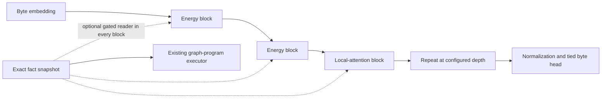

# Mixed energy and local-attention language model

The native `LM` now supports `kind='hybrid'`: every third mixer uses causal
sliding-window attention, while the other mixers keep the existing recurrent
energy state. The ordinary full-attention and energy-only models remain
available with their original default behavior and checkpoint layouts.



The design is motivated by mixing recurrence with local attention, as studied
in [Griffin](https://arxiv.org/abs/2402.19427). This implementation uses this
repository's energy mixer and ordinary multi-head attention; it is not an
implementation or reproduction of Griffin.

## Cache and execution

Each energy block keeps its fixed precision and information tensors. Each
local-attention block keeps at most `attention_window` keys, values and segment
IDs, plus the absolute next-position counter. RoPE continues from the true
position after old keys are discarded. Segment masks preserve per-example
reset boundaries. Returned cache tensors own compact allocations rather than
views that retain an entire prefill buffer.

Local attention evaluates query blocks of at most one window against at most
two windows of keys. It never creates a full sequence-by-sequence mask in that
path. This bounds the attention workspace per block; it does not eliminate
linear token activations, model weights, energy-kernel workspace, or optimizer
memory. State-size results count all returned tensors, including metadata.

`kind='softmax', attention_window=0` remains full causal attention. Giving that
model a positive window produces the windowed Transformer control. For the
mixed model, a positive window and at least one attention layer are required.
`attention_every=3` selects layer indices 2, 5, 8, and so on. A mixed checkpoint
must be trained for its mixer layout; an old energy checkpoint cannot simply
be relabelled as mixed attention.

## Existing integration

The optional fact readers, exact SQL facts, graph programs, revision-triggered
state reset and experimental block-local PC-ALM trainer remain available.
Backpropagation is the default. The comparison deliberately disables external
fact memory in every arm to isolate the language-model mixer change.

The trained six-layer memory-reader checkpoint from the earlier integration
is preserved. It is distinct from this study's small, newly initialized mixed
model. Its earlier single-fact generalization failure remains documented in
the [integration report](../hybrid_integration/REPORT.md).

## Training interface

```bash
OMP_NUM_THREADS=2 MKL_NUM_THREADS=2 .venv/bin/python -m energy_real.train \
  --kind hybrid --attention-window 64 --attention-every 3 \
  --width 64 --layers 3 --heads 2 --slots 8 --ff-width 192 \
  --device cpu --amp none --seq 128 --batch 8 --steps 1000 \
  --out runs/my_mixed_model
```

The trainer adjusts feed-forward width for the number of attention layers to
approximately match the energy-only parameter budget. The actual count is
recorded. Exact resume records the window and mixer schedule in the configuration
identity. This example is a new run, not a reproduction of the controlled study;
use the dedicated study command for the matched four-arm experiment.

```bash
OMP_NUM_THREADS=2 MKL_NUM_THREADS=2 .venv/bin/python -m energy_real.competitive_study \
  --out runs/competitive_reproduction --steps 1000 --seeds 11 22 33 \
  --max-seconds 5400
```

Runs refuse an existing output directory. The study charges its time to the
shared eight-hour research ledger; completed studies are not silently repeated.
The study saves validation-selected weights, not resumable optimizer snapshots.
For interruptible standalone training, use the main trainer and `--resume`.

To load and greedily sample the validation-selected mixed checkpoint on CPU:

```bash
.venv/bin/python -m scripts.sample_native \
  --checkpoint runs/competitive_native/selected_hybrid.pt \
  --prompt 'The ' --tokens 128
```

This small checkpoint predicts bytes; it is not an instruction-tuned assistant.
