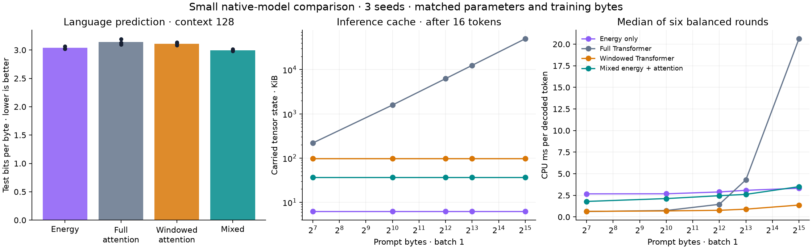
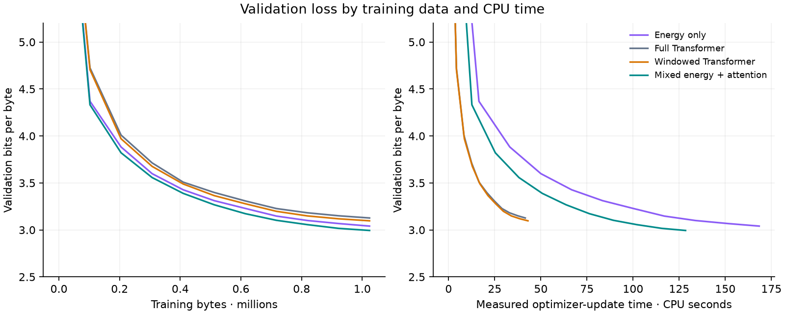

# Native energy / Transformer comparison

The mixed model beats the full-attention Transformer on the measured test loss at both contexts, with conditional paired-window intervals below zero.

At a 32,768-byte prompt it uses **1,363.4× less carried tensor state** than full attention. The full-attention / mixed median decode-latency ratio is **5.88×** on this CPU (above one favors mixed).

**Scope:** three freshly trained seeds per arm, approximately 145,000 parameters, 1.024 million training bytes per fit, one preserved local enwik8 corpus, CPU float32. This is not evidence of general superiority over well-tuned or large Transformers. The existing 10.6-million-parameter checkpoints were preserved; they were not retrained or replaced.

## Test language prediction

Each cell is mean bits per byte across all three validation-selected checkpoints; lower is better. Test windows reset model state. The 512-byte evaluation is a context-length extrapolation from 128-byte training.

| Model | Parameters | Test, 128 bytes | Test, 512 bytes | Mean training seconds |
|---|---:|---:|---:|---:|
| Energy only | 145,164 | 3.0369 | 2.9913 | 168.38 |
| Full Transformer | 145,179 | 3.1394 | 3.3681 | 41.56 |
| Windowed Transformer | 145,179 | 3.1119 | 3.0596 | 43.02 |
| Mixed energy + attention | 145,169 | 2.9979 | 2.9469 | 128.46 |

Hybrid-minus-control differences in bits per byte (negative favors mixed):

| Context | Control | Mean difference | Conditional 95% interval |
|---:|---|---:|---:|
| 128 | Energy only | -0.0390 | [-0.0450, -0.0329] |
| 128 | Full Transformer | -0.1415 | [-0.1543, -0.1293] |
| 128 | Windowed Transformer | -0.1140 | [-0.1246, -0.1038] |
| 512 | Energy only | -0.0444 | [-0.0484, -0.0404] |
| 512 | Full Transformer | -0.4211 | [-0.4332, -0.4091] |
| 512 | Windowed Transformer | -0.1127 | [-0.1200, -0.1052] |

Intervals resample test windows after averaging paired differences over the three seeds. They are conditional on these trained seeds and do not quantify all training-seed uncertainty; random corpus crops can overlap. Per-seed losses and window rows are preserved. Every arm sees identical minibatches within each seed. The common optimizer schedule was fixed without architecture-specific hyperparameter tuning.

Full-Transformer quality gate: **passed**. Additional comparison with the windowed Transformer: **passed at both contexts**.

Compute is deliberately reported separately. Equal optimizer updates and tokens do not make these different mixers FLOP- or wall-time-matched. The timing includes forward/backward/optimizer work, excluding validation and checkpoint I/O. The data-matched test result must not be described as a compute-matched win.

## Long-context inference

Median of six rounds, batch one, 16 identical teacher-forced decoding tokens after prefill. Arm order rotates and reverses across rounds. These are native forward-pass timings, excluding token sampling and request serving. The GPU was occupied by an unrelated workload and was not used.

| Model | State after 32,768 + 16 bytes | Decode ms/token | Prefill seconds |
|---|---:|---:|---:|
| Energy only | 6,336 B | 3.323 | 1.834 |
| Full Transformer | 51,143,040 B | 20.620 | 3.344 |
| Windowed Transformer | 99,864 B | 1.376 | 0.643 |
| Mixed energy + attention | 37,512 B | 3.505 | 1.360 |

State counts include all returned keys, values, recurrent tensors, segment IDs, and absolute-position counters. They exclude parameters, activations, optimizer and process overhead. Parameter bytes are reported separately in the JSON. The windowed Transformer also has bounded state and is an essential control; cache reduction alone is not an energy-specific discovery. The full-attention implementation extends its cache with tensor concatenation; optimized static or paged caches and GPU kernels were not measured. There is no 32K language-quality result in this study.

Full attention decodes faster than mixed at the measured 128-, 1024-, and 4096-byte prompts. Mixed is faster at 8192 and 32768 bytes. The windowed Transformer decodes faster than mixed at every measured length, while mixed has lower test loss and less carried state. This is a measured tradeoff, not dominance on every metric.

## Implementation and verification

- A configurable mixed layer schedule and bounded local attention are integrated into the native `LM` and resumable trainer.
- The full attention and energy-only defaults retain their old layouts and bitwise checkpoint behavior.
- Causality, independently recomputed attention outputs/gradients, mixed streaming/reset behavior, compact cache storage, activation checkpointing, fact-reader composition, and exact training resume are checked.
- Root suites: 265 passed, 32 skipped. Spark: 83 passed, 2 skipped. Total: **348 passed, 34 skipped**.
- A non-editable wheel imports outside the checkout, matches installed source bytes, and passes mixed-model streaming plus local-PC-ALM backward smoke checks.

See [architecture and commands](ARCHITECTURE.md), [backward compatibility](backward_compatibility.json), [installation](installation.json), [root tests](tests_root.log), and [Spark tests](tests_spark.log).

A [greedy-generation smoke check](sampling_smoke.json) on the first completed mixed checkpoint loads and streams correctly, but repeats short phrases. The lower byte-prediction loss should not be confused with assistant-quality generation.

## Artifacts and selection

All arms choose their lowest-validation-loss checkpoint, including initialization. The complete selection was frozen before test prediction. The selected seed for each arm is also chosen by validation, and is used for inference profiling. The long-context extension was declared during seed-11 training and does not change model selection.

[Selected mixed checkpoint](../../runs/competitive_native/selected_hybrid.pt) · [Selected full Transformer](../../runs/competitive_native/selected_softmax.pt) · [Results](results.json) · [Frozen plan](plan.json) · [Selection](selection.json) · [Fit costs](fits.json) · [Per-window test scores](../../runs/competitive_native/test_rows.json) · [Profile rounds](../../runs/competitive_native/profile_rows.json) · [Long-context plan](long_context_plan.json) · [Long-context rounds](../../runs/competitive_native/long_context/rows.json)

[Training source archive](../../runs/competitive_preservation/training_source.tar.gz) · [Source hashes](training_source.json) · [Shared cumulative time ledger](budget.json) · [Non-editable wheel](../../runs/competitive_install/wheels/energy_transformer_research-0.16.0-py3-none-any.whl)

The [artifact manifest](artifacts.json) records the final files and preserved-checkpoint audit.

Checkpoints, datasets and per-window scores remain local under `runs/`. Earlier source and reports were archived before editing; earlier report bytes and all three original model checkpoint hashes are preserved.
