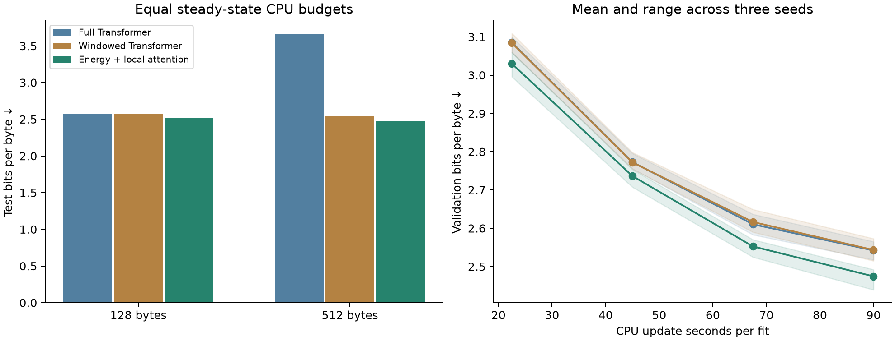

# Compute-controlled confirmation

The hybrid passed the predeclared prediction-quality gate against both Transformer controls at equal steady-state CPU update budgets. This is evidence about approximately 145,000-parameter byte models on one corpus. It is not evidence of general superiority over modern large Transformers.

## What changed in the comparison

The [first follow-up](../stronger_comparison/REPORT.md) was effectively tied at the trained context length. Machine contention exposed a weakness in rotating one update at a time: the more expensive model finished its CPU allowance earlier and experienced a different period of host load.

This confirmation pins every arm to CPU 19, rotates **0.5-CPU-second blocks**, compiles every training objective, and uses foreach AdamW for every arm. The compiler check verified gradients for both controls and the hybrid; forward/backward CPU time fell from 27.2 to 20.5 ms for the hybrid, and by about 8–9% for the controls. No layer arrangement, parameter budget, memory reader, or language-model recurrence was changed.

Each arm gets three 20-CPU-second learning-rate pilot fits and three fresh 90-CPU-second main fits. Learning rates and checkpoints are selected on validation; all selections are frozen before fresh test-window evaluation. Training is float32, batch eight, 128 bytes, with the same minibatch-stream prefix within each seed. Faster models see more bytes.

## Held-out prediction

Mean bits per byte across three validation-selected seeds; lower is better. CPU and wall seconds cover updates only.

| Model | Test bpb, 128 | Test bpb, 512 | CPU seconds | Wall seconds | Training bytes |
|---|---:|---:|---:|---:|---:|
| Full Transformer | 2.5782 | 3.6625 | 90.01 | 90.36 | 3,454,635 |
| Windowed Transformer | 2.5770 | 2.5437 | 90.01 | 90.43 | 3,474,432 |
| Energy + local attention | 2.5121 | 2.4722 | 90.02 | 90.39 | 2,993,835 |

| Model | Seed 404, 128 bytes | Seed 505, 128 bytes | Seed 606, 128 bytes |
|---|---:|---:|---:|
| Full Transformer | 2.5776 | 2.5937 | 2.5633 |
| Windowed Transformer | 2.5767 | 2.6038 | 2.5506 |
| Energy + local attention | 2.5366 | 2.5314 | 2.4684 |

| Context | Control | Hybrid minus control, bpb | Conditional 95% interval |
|---:|---|---:|---:|
| 128 | Full Transformer | -0.0661 | [-0.0755, -0.0567] |
| 128 | Windowed Transformer | -0.0649 | [-0.0736, -0.0564] |
| 512 | Full Transformer | -1.1904 | [-1.2199, -1.1601] |
| 512 | Windowed Transformer | -0.0715 | [-0.0768, -0.0664] |

Negative differences favor the hybrid. Bootstrap intervals resample windows after averaging paired differences across these three seeds. They do not quantify all seed uncertainty; random crops can overlap. The 512-byte evaluation extrapolates beyond the 128-byte training context. It is not a long-distance recall test.

## Compute and measurement limits

The largest CPU-progress spread at a completed main scheduling round was **0.0335 seconds**. Validation-point host load ranged from 6.2 to 26.0. A fixed core and short blocks improve the comparison, but this is still a shared machine; CPU seconds are not FLOPs or GPU compute.

The equal budgets cover **steady-state updates**. Compilation, data loading, validation and checkpoint I/O are excluded equally. Recorded compiler warmup wall-time totals across pilot and main fits were {'softmax': 7.416, 'local_softmax': 5.705, 'hybrid': 21.618} seconds. Those warmups reused a compiler cache populated by the probes and an aborted pilot; they are not cold-start costs. The [compiler probe](../stronger_comparison/compile_probe.json) separately records its initial compile costs. No end-to-end training-cost win is claimed from the update-only comparison.

An initial confirmation pilot was stopped after discovering that contiguous dummy inputs did not match the real overlapping crop views, causing recompilation inside the timer. Warmup now matches the input strides and aliasing; the failed attempt and its log remain preserved. No test evaluation or checkpoint promotion occurred in that attempt.

## Implementation and inference

The CPU kernel now reduces the slot contraction explicitly and handles one-token recurrence directly. The preserved-weight timing experiment measured **1.75× faster updates at the same chunk size**, **2.05× with chunk size eight**, and **3.15× faster 32K-prefix decoding than the preallocated full Transformer**, with **1,363× less carried cache/state**.

Those inference measurements use the earlier preserved weights and eager CPU execution, separately from this compiled-training quality experiment. The preallocated full Transformer is faster at 4K; windowed attention is faster at all measured lengths. Small cache size does not establish better long-distance recall. Full timing rows, cache capacity accounting and scope are in [the implementation comparison](../stronger_comparison/REPORT.md).

## Artifacts

- [Frozen plan](plan.json), [results](results.json), [selection](selection.json), [full training log](training_v2.log), [audit](audit.json)
- [Selected native checkpoint record](selected_checkpoint.json): `runs/compute_confirmation_selected/hybrid.pt`, seed 606
- All fit checkpoints, input windows, histories and scheduling rows: `runs/compute_confirmation_v2/`
- Frozen source: `runs/stronger_preservation/confirmation_v2_source.tar.gz`
- 247 earlier report/checkpoint artifacts verified unchanged.

The selected checkpoint remains compatible with `energy_real.sample`. Earlier large checkpoints were preserved. GPU throughput, large-model quality, broad language tasks, reasoning and production serving remain unestablished.

Compiled/eager checks on real overlapping crop views and trained checkpoints passed, with maximum absolute gradient error 1.68e-07. See [gradient verification](compiled_verification.json), [root tests](tests_root.log), and [Spark compatibility tests](tests_spark.log). The initial test-discovery attempt traversed archived source copies; the complete live suites were then run explicitly by directory.

An [isolated wheel installation](installation_verification.json) verifies all 53 package source files, the selected checkpoint, chunked sampling, exact CLI bytes and preallocated-cache parity outside the checkout.
