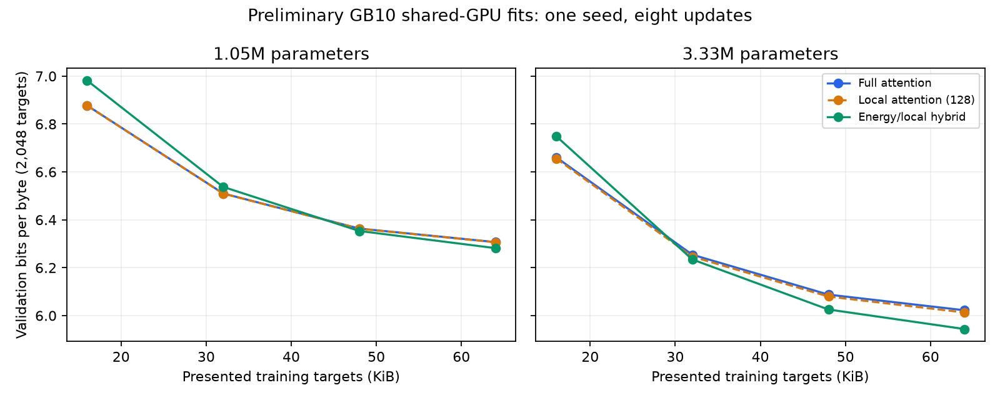

# Shared-GPU probe: measured results

All six admitted small-model fits completed on the GB10 under the 4 GiB Torch allocation cap. Existing services were not stopped. Pure energy was excluded after failing BF16 gradient parity; no threshold was relaxed.

| Family | Parameters | Validation bpb | Peak Torch allocated (MiB) | Peak Torch reserved (MiB) |
|---|---:|---:|---:|---:|
| Energy/local hybrid | 1,047,809 | 6.2817 | 134.3 | 152.0 |
| Local attention (128) | 1,048,086 | 6.3062 | 95.5 | 98.0 |
| Full attention | 1,048,086 | 6.3069 | 95.1 | 98.0 |
| Energy/local hybrid | 3,329,170 | 5.9437 | 237.2 | 252.0 |
| Local attention (128) | 3,330,012 | 6.0130 | 165.3 | 170.0 |
| Full attention | 3,330,012 | 6.0222 | 151.1 | 156.0 |

Each fit used seed 404, 65,536 presented targets, context 512, microbatch 1 and 16-way accumulation for eight updates. All fits saw the same sampled data stream. Validation covered only 2,048 targets and was checked every two updates. Peak LR was fixed at 0.001. Models are far from converged; these observations establish fit and preliminary learning, not a scaling law or general superiority.

Torch peaks exclude CUDA context and other non-Torch allocations. GPU contention invalidates comparative timing. The exclusive campaign, compiled production acceptance and full restart audit remain outstanding.

## Retained failures and diagnosis

- First attempt failed before numerical checks because Torch required an explicit CUDA index for its memory-cap API. The compatibility fix passed focused and installed-package tests.
- Second attempt hit the host-memory reserve as foreign workloads grew, and its worker also reported a BF16 failure. Both records were retained.
- After memory recovered, diagnostic replay measured pure-energy relative gradient error **1.0656** and cosine **0.7947**, outside the unchanged limits of <0.30 and >0.95. Hybrid measured **0.0392 / 0.99937**; full attention **0.00556 / 0.99998**.
- Replaying the saved failing weights and tokens on CPU also produced a large BF16 gradient error (**0.9696**). This points to numerical sensitivity rather than contention alone. The cause is not yet established; do not claim a precision fix.
- Selected hybrid/attention fixtures subsequently passed recurrence, streaming/reset/causality, checkpoint-gradient, FP32 CPU/GPU and BF16 checks before their fits. Pure energy remains blocked.

All subprocess work, including failures and diagnosis, charged **99.14 seconds** to the original ledger: acceptance 25.29s and backbone 73.85s. No new 24-hour budget was created.

Raw checkpoints/logs are in `runs/campaign/shared_probe_003`; failures and replay tensors are in `shared_probe_001` and `shared_probe_002`. The next technical task is to localize pure-energy BF16 gradient sensitivity using the saved fixture. Do not promote models or enlarge the study from these preliminary results.
