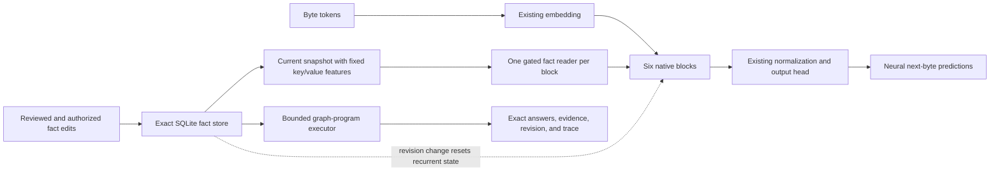

# Current native hybrid architecture

The integrated model keeps the existing byte-language backbone and adds exact
fact storage, a learned reader in every native block, and bounded graph
programs. Backpropagation remains the default training rule. PC-ALM is an
experimental alternative for training across block boundaries.

## What is incorporated

**Native energy memory stays intact.** Each original mixer still carries its
precision/information state, uses the fixed causal kernel, and makes its two
reads. The added fact workspace stores current relations and provenance
explicitly. Neural readers receive a feature view of this workspace; they do
not replace the exact records or authorize writes.

**A reader in each block.** After the native mixer residual, a normalized hidden
state generates a query over fixed fact-address features. Softmax weights mix
fixed object features, with an explicit null candidate. A learned projection
maps the read into model width. A scalar `tanh(gate)` controls the residual
contribution before the feed-forward network. All gates start at zero.

This ports the useful per-block memory-reader pattern from the earlier study.
The native extension uses exact external storage and a learned content reader;
it does not copy the small prototype's controller weights or add another dense
precision matrix. Fixed hashed features can collide and are not a trained
language encoder. Neural reads are approximate; graph answers use exact IDs.

**Checkpoint preservation.** The default `Config(memory_dim=0)` retains the
original parameter layout and behavior. Explicit augmentation adds 32-dimensional
readers to the existing six-layer, width-384 checkpoint, copying every original
weight. Closed gates preserve its original output exactly. The reader-adaptation
experiment freezes all original weights, including the embedding and head.
An augmented checkpoint is a weight-only warm start, not a resumable copy of an
old optimizer run.

**Graph programs.** Instructions are `entity`, `follow`, `intersect`, and `union`.
References must point to earlier results. Programs have at most 16 instructions
and a bounded number of bindings. Execution reads one consistent snapshot and
returns supporting fact IDs, a trace, and the snapshot revision. A missing
premise causes abstention; an empty intersection is a valid empty result.
The executor never evaluates Python or executes generated code. These are
supplied reasoning primitives, not learned program discovery.

**Session consistency.** A `HybridSession` uses one fact snapshot for a token
window. If the store revision changes, it discards recurrent state before the
next window. This prevents old neural state from surviving a committed edit;
it also loses prior token context, so applications may need to prefill a current
prompt again. Split token windows at edits. A snapshot must not include facts
that become available only later in the window. Each session handles one
conversation; direct `LM.forward` callers own their state/snapshot consistency.

## Native PC-ALM training

The inferred activities are the embedding output and each native block output.
For block prediction `f_l` and activity `h_l`, the local residual is
`r_l = h_l - f_l(h_(l-1))`. The training potential is output cross-entropy plus
`sum_l [lambda_l * r_l + rho/2 * r_l^2]`.

Activities start at the feed-forward state; dual variables start at zero for
each batch. Training performs activity descent, dual ascent, and a final
activity step without a following dual update. Activities are detached between
iterations and before local parameter gradients. Autograd still differentiates
**inside each block's causal mixer**; this does not eliminate all backpropagation
or turn every scalar neuron into an independent agent. The tied input/output
embedding receives both local contributions. Inference remains the ordinary
native forward pass and never receives target labels.

The CLI records the learning rule and activity schedule in strict resume
identity. PC-ALM currently requires float32 computation. Its reported training
loss is cross-entropy at settled activities; its parameter gradient is the
local augmented objective, and validation is normal feed-forward prediction.
Native nonlinear convergence and a language-quality advantage are unproven.

## Why these choices

The [preceding experiments](../local_energy/REPORT.md) supported explicit memory
and showed PC-ALM improving ordinary predictive coding at depth, while BP remained
competitive and performed better on byte prediction. The full candidate-energy
decoder was much slower and did not outperform the stronger controls, so it
remains available as a research model rather than the default decoder. Topology
also remains a research idea; the evidence did not justify adding it here.

The resulting system combines continuous native features with explicit graph
state. It is not a complete removal of latent state or a general-purpose
reasoning model. The [integration report](REPORT.md) distinguishes verified
mechanics, reader learning on supplied symbols, and outstanding language tests.
The trained reader artifact is specifically adapted to three- and four-fact
symbol queries; a one-fact fixture exposed incorrect neural abstention. That
limitation does not affect the exact graph-program executor.
