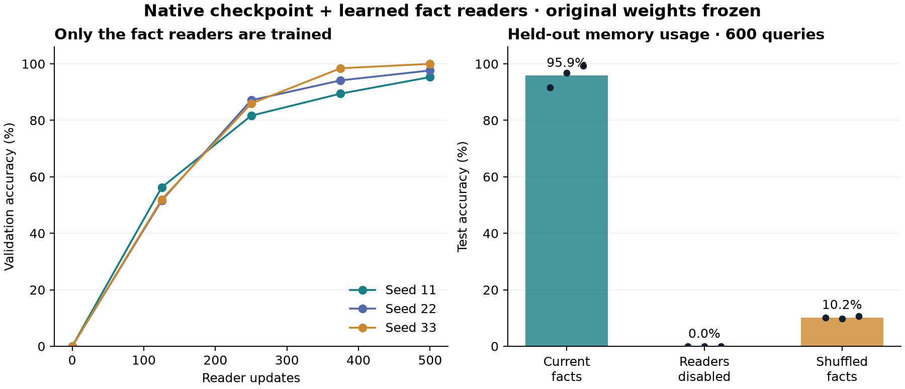

# Native hybrid integration

The current native model now has exact fact storage, a learned reader in every block, bounded graph programs, and an optional PC-ALM training rule. BP remains the default. The full candidate-energy decoder was not promoted.

Adapted the existing **10,606,896-parameter checkpoint**, adding **147,654 reader parameters**. All original weights stayed bitwise unchanged. Three minibatch seeds each ran 500 reader-only updates. Validation selected seed **33**, step **500**, before test evaluation.

The original 30-minute run completed all training and froze selection, then reached its deadline during evaluation. A separate bounded evaluation continuation used the same source, checkpoints, and test data. It repeated no training updates and changed no selection decisions.

## Measured integration

| Native model condition | Mean test accuracy |
|---|---:|
| Learned readers with current facts | 95.94% |
| Same checkpoint, fact readers disabled | 0.00% |
| Same checkpoint, facts shuffled across examples | 10.22% |

**This is an access/usage ablation, not a fair algorithm comparison:** the disabled condition has no fact input. The task supplies the grammar `ar?` / `as?` / `br?` / `bs?`, six answer symbols, and event semantics. Examples independently sample assignments of objects to addresses. Test uses 600 independently generated examples; the fixed symbol vocabulary is shared across splits. These results establish learned use of the memory hook, not natural-language understanding or broad reasoning. 87 of 600 test inputs exactly match a training prompt/current-fact combination; this is not a strictly disjoint-combination or novel-vocabulary benchmark. A post hoc audit of the remaining 513 combinations gives 95.32% mean accuracy, without changing any selected checkpoint.

| Training seed | Selected step | Memory enabled | Disabled | Shuffled |
|---|---:|---:|---:|---:|
| 11 | 500 | 91.67% | 0.00% | 10.17% |
| 22 | 500 | 96.83% | 0.00% | 9.83% |
| 33 | 500 | 99.33% | 0.00% | 10.67% |

| Fact event | Mean accuracy with memory |
|---|---:|
| set | 96.22% |
| replace | 95.11% |
| delete | 100.00% |
| hold | 92.44% |

The exact graph-program path scored **100.00%** on **360** fresh diagnostics across 12 families, including missing multi-hop evidence, replacement, deletion, and distractors. It uses supplied typed relations and path programs. Branching intersection/union semantics, missing-premise abstention, and provenance are covered by unit tests.

## Compatibility and local training

Existing checkpoints retain their original layout with `memory_dim=0`. Explicit augmentation creates a separate weight-only checkpoint with closed reader gates; numerical tests verify original outputs exactly. After reader training, disabling memory still produces bitwise identical logits to the parent model. This does not guarantee unchanged text generation when the trained readers are enabled.

The native PC-ALM option cuts credit propagation between blocks and keeps autograd inside each causal mixer. Activity iterations are detached and targets are used only during training. A linear equilibrium check matches the BP gradient; native nonlinear tests verify finite gradients and exact interrupted/resumed optimizer state. No new large native-LM comparison establishes a language-quality gain for PC-ALM.

## Verification

- **334 tests passed, 33 skipped:** 250 root/repaired tests plus 84 Spark tests.
- A noneditable wheel imported outside the checkout; all 35 installed native-package source files matched.
- The installed package passed graph execution, a native session forward pass, and PC-ALM backward.
- Active-reader outputs and every parameter gradient matched exactly with and without activation checkpointing.
- The selected full-size checkpoint passed persistent SET/replace/HOLD/DELETE session checks. Every revision reset matched a fresh forward pass.
- Original checkpoint bytes, original weights, and earlier report bytes were preserved.
- CPU only; reader training used the existing cumulative research ledger. No GPU training or efficiency claim.

The readers add about **1.4%** to the original parameter count. Native recurrent state remains **148,992 bytes** per conversation; fact tensors add **1,028 bytes** for four facts or **65,792 bytes** at capacity 256. This is tensor accounting, excluding SQLite/provenance, activations, optimizer, and process overhead. See [footprint.json](footprint.json).

## Use the integrated model

[Selected native checkpoint](../../runs/hybrid_native/selected.pt) · [Runtime manifest](runtime.json) · [Architecture](ARCHITECTURE.md) · [Commands](../../energy_real/README.md#native-hybrid-architecture)

[Matching source archive](../../runs/hybrid_preservation/final_source.tar.gz) and [verified installable wheel](../../runs/hybrid_install/wheels/energy_transformer_research-0.16.0-py3-none-any.whl) are preserved locally with the checkpoint.

Use `HybridSession.load(checkpoint, FactStore(path))` for memory-aware native inference and `session.answer(GraphProgram.path(subject, relations))` for exact graph answers. Existing explicit write authorization and revision checks remain in force. A committed revision discards old recurrent state, so applications may need to prefill current context again.

The selected reader checkpoint is adapted to a narrow symbol-binding task. Use graph programs for evidence-backed fact answers; its free-form generated text is not guaranteed to follow the facts. Plain native byte training without aligned fact snapshots cannot train the new readers.

**Observed transfer limit:** in the one-fact persistent-session fixture, the neural decoder returned `?` for all **3 known answers**, although graph execution returned each fact correctly. The reader was trained on three- and four-fact snapshots; its high test score does not cover this size change. In the separate [supported-size session fixture](supported_session.json), both the neural decoder and exact executor handled all four SET/replacement/HOLD/DELETE cases correctly. Both fixtures are preserved. Treat the learned reader as experimental; use exact graph programs for reliable factual answers.

[Machine results](results.json), [frozen selection](selection.json), [session evidence](session_verification.json), [installation evidence](installation.json), [artifact checksums](artifacts.json). Raw histories, predictions, and all three checkpoints remain in `runs/hybrid_native/`.

Core source: `a01b6feaec70f9ef568c5c15b69293bf5269d8321c985e3faa4d103de92ebafa`.
