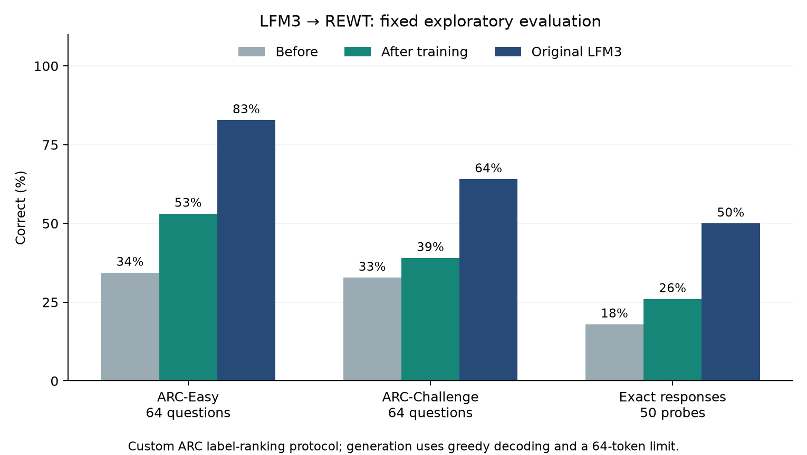
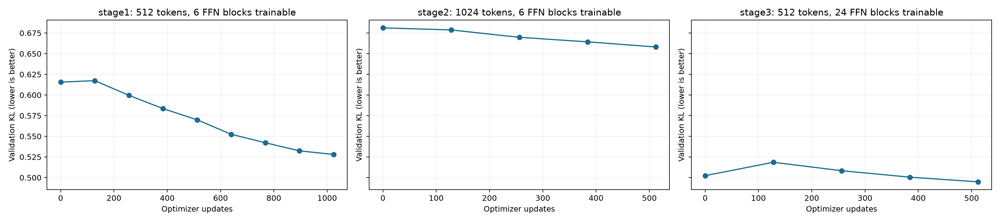

# LFM3 → streaming REWT: capability recovery attempt

**Recommended artifact: stage 2.** Stage 3 reduced validation KL further, but scored 58/128 on science and 9/50 on exact responses, versus stage 2’s 59/128 and 13/50. The recommended bundle therefore uses stage 2. This is a post-hoc recommendation from the small capability suite, not an independent confirmation result. Both versions remain available. [Selection record](selection.json) · [Stage 3 raw results](stage3_capabilities.json).

The selected model changes the small science score from **43/128 to 59/128** and exact-response checks from **9/50 to 13/50**. The original donor scores 94/128 and 25/50 under the same protocol. **Full LFM3 capability recovery is not established.**

Three passes consumed 1,663,386 additional real-token exposures in total. The recommended stage-2 checkpoint includes only the first two passes: 1,290,243 exposures and 1,536 optimizer updates. Its short-crop validation KL is 0.5024, versus 0.6156 before this attempt. The third pass is retained as an unsuccessful broader adaptation experiment.

This experiment continues the standalone converted checkpoint with broader instruction data, short conversations, answer-weighted distillation, and feedforward adaptation. The original converted checkpoint remains available. **These measurements establish the result of this recovery attempt, not equivalence to LFM3.**

## Fixed before/donor/after comparison

| Check | Before | After recovery | Original LFM3 |
|---|---:|---:|---:|
| ARC-Easy (custom label ranking) | 22/64 (34.4%) | 34/64 (53.1%) | 53/64 (82.8%) |
| ARC-Challenge (custom label ranking) | 21/64 (32.8%) | 25/64 (39.1%) | 41/64 (64.1%) |
| Exact format | 1/8 (12.5%) | 1/8 (12.5%) | 5/8 (62.5%) |
| Arithmetic, exact output | 0/8 (0.0%) | 0/8 (0.0%) | 0/8 (0.0%) |
| Factual answers, exact output | 4/8 (50.0%) | 4/8 (50.0%) | 3/8 (37.5%) |
| Python output, exact output | 0/6 (0.0%) | 0/6 (0.0%) | 1/6 (16.7%) |
| JSON extraction | 4/4 (100.0%) | 4/4 (100.0%) | 4/4 (100.0%) |
| JSON routing (no tool execution) | 0/4 (0.0%) | 0/4 (0.0%) | 4/4 (100.0%) |
| Code recall, 77-token prompts | 0/4 (0.0%) | 4/4 (100.0%) | 2/4 (50.0%) |
| Code recall, 561-token prompts | 0/4 (0.0%) | 0/4 (0.0%) | 4/4 (100.0%) |
| Code recall, 1,265-token prompts | 0/4 (0.0%) | 0/4 (0.0%) | 2/4 (50.0%) |

All 128 ARC questions and 50 generation probes are fixed in [evaluation_suite.json](evaluation_suite.json). The same prompts, tokenizer, non-thinking chat template, BF16 execution, greedy decoding, repetition penalty 1.0, and 64-new-token limit apply to all models. The science task ranks single-token answer labels at the first generation position; this is a custom zero-shot protocol, not a published ARC/lm-eval score.

Exact-output scores combine answer content with instruction compliance. For example, `38 + 27 = 65` fails a request for only `65`. JSON is compared as parsed objects. Responses reaching the output limit may be incomplete. The donor can emit reasoning despite the non-thinking prompt; its model card documents that inconsistency. These small probes are not broad knowledge, coding, agent, or long-context benchmarks.

The strict-score improvement is concentrated in short code-recall formatting: stage 2 gives all four bare codes at 77 tokens. At 561 and 1,265 tokens, it fails to return the correct code in all eight cases, while the donor retrieves all eight correctly. Arithmetic and Python-output strict scores remain 0/8 and 0/6, and tool-call JSON remains 0/4. These strict failures must not be interpreted as a complete content-accuracy assessment.

A [separate recall-content diagnostic](recall_content_diagnostic.json), added after inspecting baseline responses, counts correct five-digit codes even when the model adds prose. This distinguishes forgotten information from an output-format error; it does not replace or alter the original strict scores.

Paired science outcomes: 25 previously wrong questions became correct; 9 previously correct questions became wrong. Paired exact-response outcomes: 4 gains and 0 losses.

[All raw starting responses](before.json) · [All raw recovered responses](after.json) · [All raw donor responses](teacher.json) · [Paired changes](paired_changes.json)



## Training and selection

The new corpus contains 16,100 training conversations (9,797,398 stored tokens), including 8,931 shorter than 513 tokens, and 263 validation conversations. It is selected from the pinned official SmolTalk training shard, with larger proportions of code and constrained-instruction examples. Hash buckets preserve the original split rule. Old validation/test conversations are excluded, and new validation excludes all old training conversations.

Documents never share a training row. Right padding has zero loss; assistant targets have weight 1 and other real targets weight 0.1. Three quarters of crop choices retain the beginning of the conversation. The corpus audit found no identical full token sequences or 128/512-token prefixes shared between the new training set and any checked validation/test set. Semantic overlap and donor pretraining contamination are not ruled out.

The objective is exact full-vocabulary KL(teacher || student) + 0.2 hard next-token loss + 0.05 relative hidden-state MSE. Mixers/operator norms/energy parameters train at the main learning rate; unfrozen feedforward blocks, their FFN norms, and the final normalization train at a reduced rate. Stages 1–2 unfreeze the last six FFN blocks at 0.2 times the main rate. Stage 3 unfreezes all 24 FFN blocks at 0.5 times the main rate to test whether the earlier frozen blocks limit adaptation. Token embeddings remain frozen throughout. Trainable weights and Adam states use FP32, with BF16 autocast and activation checkpointing.

Within each training run, checkpoint selection uses only the fixed answer-weighted validation KL. The starting checkpoint is eligible, so worse validation updates are not promoted. These are exploratory experiments on one training trajectory; baseline and first-pass capability results were inspected during the work, and limited first-pass recovery motivated the full FFN adaptation pass. No benchmark prompt, answer, or test conversation was supplied to training.

| Stage | Updates | Real token exposures | Initial → best validation KL | Selected step | Peak CUDA allocation |
|---|---:|---:|---:|---:|---:|
| stage1 | 1024 | 739,862 | 0.6156 → 0.5280 | 1024 | 16.76 GiB |
| stage2 | 512 | 550,381 | 0.6813 → 0.6581 | 512 | 16.83 GiB |
| stage3 | 512 | 373,143 | 0.5024 → 0.4949 | 512 | 29.42 GiB |

| Evaluated checkpoint | Science questions | Exact responses |
|---|---:|---:|
| [stage1](stage1_capabilities.json) | 51/128 | 10/50 |
| [stage2](stage2_capabilities.json) | 59/128 | 13/50 |
| [stage3](stage3_capabilities.json) | 58/128 | 9/50 |

## Continuation and implementation checks

On 8,192 fixed token positions from the previously inspected official test split, NLL changes from 2.3468 to 2.2298; the donor is 2.3117. KL to the donor changes from 0.8280 to 0.7557. This compares continuation likelihood, not percentage of capabilities retained.

BF16 chunked decoding has relative hidden-state L2 error 0.015230. Carried state is 18.783 MiB per sequence and remains bounded after extension to 1,024 tokens; branching leaves the original state unchanged. This excludes weights and temporary allocations.

Full-width FP32 chunked decoding has relative error 1.41e-06, below the 1e-4 acceptance threshold.

Energy-off test NLL is 2.229599, versus 2.229755 with energy refinement. This single-checkpoint ablation does not establish a general energy-refinement benefit.

The separate, previously inspected demo prompts expose additional failures: the recovered model produces malformed JSON for the Maya/Boston extraction and answers `17 + 25 = 42` when asked for just the number. The four passing JSON probes above do not establish robust JSON generation. These auxiliary demos use a 48-token limit and the donor’s inherited repetition penalty of 1.1; they are excluded from the matched headline scores.

[Full continuation, energy ablation, numerical checks and previously inspected demo prompts](continuation_and_cache.json).

The final parameter audit confirms identical architecture/configuration and exactly unchanged 1,111,564,288 frozen parameters. [Parameter audit](parameter_audit.json). The REWT suite passed 279 tests; the weighted-loss gradient and short-document tests were rerun after the padding-projection optimization. [Engineering checks](engineering_checks.json).

Stages 1 and 3 share the same 512-token validation-crop settings and validation RNG seed. Stage 2 uses different, longer crops, so its absolute KL is not directly comparable. Token exposures count real targets, excluding padding, rather than nominal batch × length. Timing is on a shared GB10 and is not an isolated speed benchmark.



## Reproduce and run

Preparation uses the pinned donor and corpus source already downloaded by `scripts/prepare_rewt_lfm3.py`. The recorded plans contain every run argument and source/data/checkpoint hashes. Run preparation in a fresh output location; existing artifacts are preserved.

```bash
.venv-lfm3/bin/python scripts/prepare_lfm3_recovery.py \
  --output data/lfm3_capability_recovery_repeat
.venv-lfm3/bin/python scripts/recover_lfm3_capabilities.py \
  --initial runs/lfm3_conversion_20261028/converted/model.pt \
  --corpus data/lfm3_capability_recovery_repeat \
  --output runs/lfm3_capability_recovery_repeat --steps 1024
.venv-lfm3/bin/python runs/lfm3_capability_recovery_20261028/converted/sample.py \
  --prompt 'Explain why the sky is blue in two sentences.' --tokens 128
```

The inference bundle is standalone custom PyTorch code and weights; it does not call the donor. Its tokenizer and donor license are retained. The original 256-token attention windows, delta-memory layers and energy refinement architecture are unchanged.

[Recommended bundle instructions](../../runs/lfm3_capability_recovery_20261028/converted/README.txt) · [Standalone sampler](../../runs/lfm3_capability_recovery_20261028/converted/sample.py) · [Standalone smoke test](standalone_sample.json) · [Stage-3 alternative bundle](../../runs/lfm3_capability_recovery_20261028/validation_selected/README.txt). The smoke test runs offline from outside the repository and returns exactly `hello`.

## Sources

- [Pinned LFM3 model card](https://huggingface.co/LiquidAI/LFM3-1.7B/blob/40ebe0aa6662c9d40389c2f5d565b6a2c6aebacd/README.md).
- [SmolTalk corpus](https://huggingface.co/datasets/HuggingFaceTB/smol-smoltalk), pinned revision `f73fe857d519ff6ac5af2ea67c4d3834da7b8bcc`.
- [AI2 ARC](https://huggingface.co/datasets/allenai/ai2_arc), pinned revision `210d026faf9955653af8916fad021475a3f00453`.
