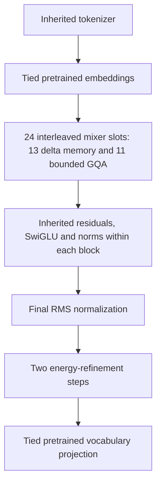

# LFM3-1.7B to streaming REWT conversion

This is a standalone architecture conversion of the pinned
[LiquidAI/LFM3-1.7B donor](https://huggingface.co/LiquidAI/LFM3-1.7B/tree/40ebe0aa6662c9d40389c2f5d565b6a2c6aebacd).
The target is the project's latest streaming REWT architecture. It is distinct
from the earlier proposal that jointly optimizes every internal state with one
energy function. The converted model refines its final latent state per token.

## What changes

| Component | Donor | Converted student |
|---|---|---|
| Vocabulary / embedding width | 128,000 / 2,048 | Inherited, tied input/output weights |
| Layers | 24 | Same residual/FFN depth and order |
| Feedforward | 7,680-wide SwiGLU | Inherited weights and sandwich norms |
| 13 short-convolution slots | LFM3 gated short convolution | Causal depthwise preprocessing, gated delta recurrence, gated readout |
| 6 full-attention slots | Global GQA | 256-token causal GQA |
| 5 sliding-attention slots | 256-token causal GQA | 256-token causal GQA |
| Attention projections | 16 query / 4 KV heads, width 128 | Inherited projections, gates, Q/K norms and RoPE convention |
| Energy refinement | None | Two steps, 64 Fourier modes, identity initialization |
| Parameters | 1,728,801,536 | 1,784,445,792 |
| Trainable in the recovery pilot | — | 389,739,360 |

No donor model object, donor convolution operator, global attention layer,
external solver or teacher is used by the student's inference path. The donor
is loaded separately during training. A local depthwise convolution remains
inside delta-memory preprocessing, as in the project's streaming REWT design.

The two mixer types remain interleaved in the donor's original layer order.

## Delta memory and transfer

For each of 16 heads, normalized keys and queries read/write a 128-by-128 state.
The recurrence is

\[
\widetilde M_t=g_tM_{t-1},\qquad
M_t=\widetilde M_t+\beta_t k_t(v_t-k_t^\top\widetilde M_t)^\top,
\qquad r_t=q_t^\top M_t.
\]

The write gate is sigmoid; retention is constrained to `(0.9, 1)`. Keys/queries
are L2-normalized. The recurrent state and chunk solves accumulate in FP32
during BF16 execution. Independent FP64 sequential-reference tests verify the
chunked recurrence and its gradients. Training uses 32-token chunks.

Donor convolution B, C and x projection slices initialize the new key, query
and value projections; C also initializes the readout gate. The depthwise
kernel and output projection transfer. **This mapping is a heuristic
initialization, not an algebraic equivalence.** Recurrence gates, read
normalization and energy parameters are new. The complete tensor mapping is
retained in `runs/lfm3_conversion_20261028/initial/transfer.json`.

Attention transfer preserves the donor's partial rotary convention, including
its frequency denominator and BF16 cosine/sine rounding. An attention-only
FP32 donor comparison had a maximum logit discrepancy of `6.33e-8` on the small
test fixture. Global attention becomes local, so equivalence is not expected
once dependencies exceed the retained window.

## Recovery objective

Stage one runs the frozen teacher on real conversations and trains each student
operator on the corresponding teacher input. Its objective is mean squared
error of the post-normalized operator output, divided by the teacher output's
mean square. Student layers are independent in this stage; the teacher supplies
their input states.

Stage two runs the complete student on the same input tokens and minimizes

\[
\mathrm{KL}(p_{\rm teacher}\Vert p_{\rm student})
+0.1\,\mathrm{NLL}_{\rm student}
+0.1\,\mathrm{relativeMSE}(h_{\rm student},h_{\rm teacher}).
\]

KL uses all 128,000 vocabulary entries at temperature one. Token chunks and
activation checkpointing bound the memory consumed by logits; the loss is not
a top-k approximation. Unit tests compare its values and gradients with the
ordinary full-logit computation. The pilot holds embedding, feedforward and
FFN-normalization weights fixed; the script also supports unfreezing all
weights for a later recovery run.

Training uses AdamW, FP32 trainable weights and optimizer states, BF16 frozen
weights and matrix operations, gradient clipping, and explicit finite checks.
Validation KL selects checkpoints. Test data is evaluated after selection.

## Data and limits

The preparation script pins
[smol-smoltalk](https://huggingface.co/datasets/HuggingFaceTB/smol-smoltalk/tree/f73fe857d519ff6ac5af2ea67c4d3834da7b8bcc).
It selects 8,192 conversations (7,635,132 tokens) from the first official train
shard. A deterministic conversation-hash bucket supplies 128 validation
conversations; 128 test conversations come from the official test shard.
Exact selected conversation duplicates are excluded across splits. This does
not establish semantic deduplication or exclusion from the donor's pretraining.

The inherited chat template disables thinking. Documents are truncated to
2,048 tokens and must contain at least 257. Every training crop stays inside a
single document; attention and recurrent state reset between examples. The
pilot samples two 256-token crops per update. A follow-on recovery stage
samples two 512-token crops per update, restricted to documents with at least
513 tokens, so the converted global-attention slots train beyond their new
256-token window. It continues the pilot checkpoint with a fresh optimizer;
it is not an exact optimizer-state resume. Metrics cover all next-token
positions, including user and template tokens, rather than assistant answers
alone. This is a limited chat-recovery experiment; it does not certify general
knowledge, tool use, coding, thinking or long-context quality.

An exact replay of sampling found only 8/768 pilot crops and 4/1,024 longer-run
crops began at conversation start. A final short recovery pass therefore uses
512-token prefixes from eligible training conversations, with separate prefix
validation. The sampler exposes `--train-prefix-fraction` and
`--eval-prefix-fraction` so future recipes can mix conversation starts with
interior crops. Fraction zero preserves the original random-crop RNG stream;
fraction one always retains the beginning of the conversation. This addresses a measured
input-distribution gap but does not itself establish instruction recovery.

Inference stores fixed-size delta matrices and at most 255 prior KV positions
per attention layer. Carried state is bounded independently of prefix length.
For one sequence with BF16 activations and FP32 recurrence, this consists of
13,631,488 bytes of delta matrices, 319,488 bytes of convolution history and
5,744,640 bytes of local KV history: 19,695,616 bytes, or **18.783 MiB** once
the window fills. This excludes model weights, temporary activations, allocator
reserves, and Python overhead. It is not the model's total RAM requirement.
The reference full-sequence attention implementation can still allocate a
quadratic mask; the sampler prefills in bounded chunks. No inference speed
advantage over the donor is asserted without a matched benchmark.

The weights remain derivatives of the donor. Its original `LFM Open License
v1.0` is retained with the local artifact; this report does not relicense it.
