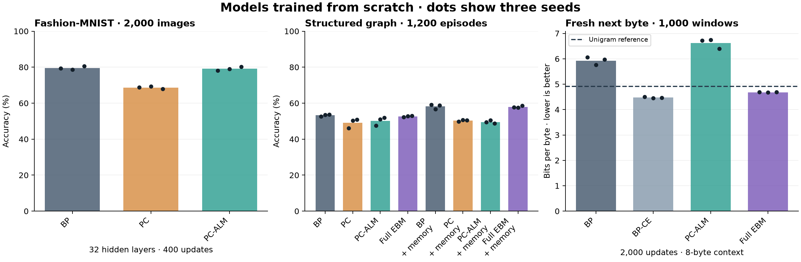
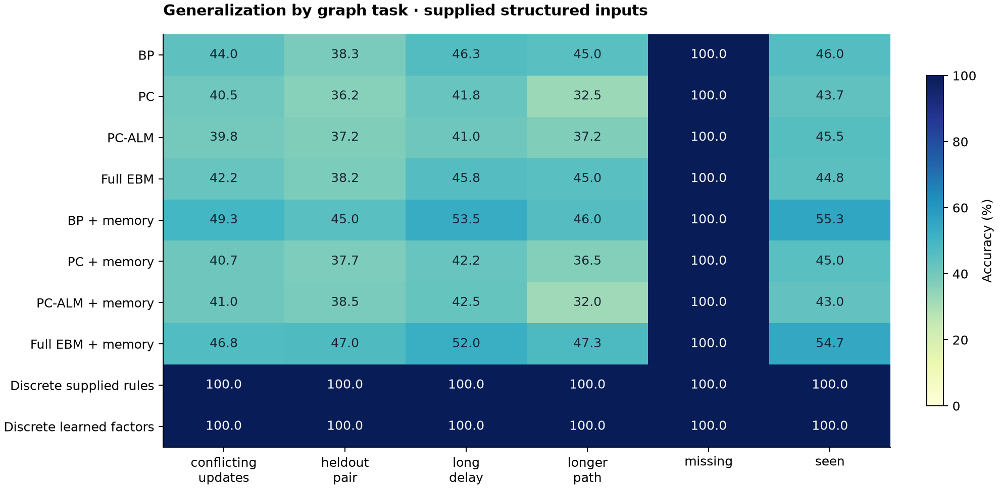

# Local learning, energy modules, and full energy models

Implemented and trained **72 models across three seeds**, totaling **60,000 parameter updates**: 57 main neural fits, 12 longer byte-model fits, and three learned discrete models. A separate 19-fit validation-only pilot preceded the main study. All research runs used CPU; GPU time was zero. These are small, controlled prototypes, not a replication of Sakana's large experiments or a usable language model.

The evidence supports two components: PC-ALM improves deep local credit assignment over ordinary predictive coding, and an explicit energy memory helps a neural energy predictor. Neither establishes an advantage over the matching backpropagation control. The discrete results favor explicit structure for this particular graph task, while leaving learned grounding and program discovery unresolved.

| Question | Measured result, mean of three seeds | Conclusion |
|---|---|---|
| Does PC-ALM help deep local learning? | At 32 layers: PC 68.68%, PC-ALM 79.15%, BP 79.53% | Recovers 10.47 percentage points over PC; close to BP |
| Does the energy memory module help a full EBM? | Graph EBM 52.67% → 57.97%; BP with memory 58.19% | Memory helps by 5.31 points; no advantage over BP with memory |
| Can an EBM learn byte patterns? | Fresh test: EBM 4.682 bits/byte, BP-CE 4.472, unigram 4.917 | Learns beyond byte frequencies, but BP-CE predicts better |
| Can explicit discrete state solve these graph tasks? | Fixed rules and learned seven-factor model both 100% | Yes with supplied event semantics and path execution; not learned general reasoning |

## What was implemented

- Independent residual predictors with BP, predictive coding, and PC-ALM learning. The latter two settle detached activities and update weights from local errors; PC-ALM adds temporary dual variables.
- A causal quadratic memory module with exact SET/DELETE/HOLD semantics and learned readers in each residual block.
- A full **conditional** EBM: each possible answer defines an energy problem; prediction relaxes hidden states for every candidate and selects the lowest energy. Training uses discriminative energy loss. This is supervised classification/next-byte modeling, not unconditional density modeling.
- A discrete path-energy implementation, plus a trainable version with seven scalar factor weights and exact sum-product inference. Entity IDs and path bindings replace learned dense hidden embeddings in this model.
- Frozen checkpoint selection, resumable optimizer/RNG state, source and data fingerprints, CPU cost measurement, intermediate-state probes, and a cumulative research budget.

See [DESIGN.md](DESIGN.md) for equations, architecture, supplied assumptions, source references, and the assessment of graphs, DSLs, explicit memory, and topology. The existing language model and previous retrieval experiments were preserved.

## Local learning and memory findings

On 32-layer Fashion-MNIST, PC-ALM minus PC was **+10.47 points**, with a paired interval of **[+9.20, +11.73]**. Every seed improved. PC-ALM minus BP was **−0.38 points**, interval **[−1.15, +0.40]**; this does not establish equivalence or superiority. At eight layers all three methods were near 79%.

A second diagnostic compared derivatives at the **same frozen BP-trained 32-layer weights**, rather than comparing differently trained networks. Against the BP gradient, PC/PC-ALM cosine similarity was **0.674/0.851** at 64 activity steps and **0.659/0.951** at 128. This supports the local-credit interpretation on this example, not a nonlinear convergence guarantee.

For graph prediction, adding memory to the full EBM gave **+5.31 points [3.75, 6.83]**, with positive gains in all seeds. Against BP with the same memory module, the EBM difference was **−0.22 points [−1.03, +0.61]**. PC-ALM with memory reached only 49.50%; its inner residual sometimes increased late in relaxation. The current settings are therefore not a reliable universal local-training recipe.

Frozen first-hop probes also improved: the last-layer EBM-with-memory probe rose from **38.36% to 59.19%**, versus BP-with-memory **40.36% to 61.67%**. Probes train a separate supervised ridge readout; EBM features use the model's predicted answer, never the correct answer. These measurements show accessible intermediate information, not autonomous reasoning.

## Graph generalization and discrete state

The graph evaluation covers seen paths, an unseen two-hop composition, three-hop paths, delayed queries with 128 HOLD events, conflicting updates, and missing evidence. Every neural model gets the same complete current fact table plus the query and relation path. Memory supplies an inductive bias, not exclusive information access. All neural methods reached 100% on missing-evidence episodes, which contributes to their aggregate scores; the other groups remain substantially harder.

The discrete models receive entity identities, typed edges, update semantics, and the path-composition algorithm. The learned variant trains seven scalar factor weights and solves exactly over possible entity-ID paths. Both discrete variants scored 100% on all 1,200 test episodes. This establishes that the supplied structure is sufficient; it does not establish that the model discovers the structure, parses natural language, or learns a DSL. They should not be presented as architecture-matched wins over the neural controls.

**Research direction:** typed graphs plus executable programs and addressable memory are the strongest next candidates for replacing opaque vector state where structure is available. Topological descriptors are better auxiliary signals: connectivity alone does not preserve labels, direction, time, or provenance. Discrete latent variables remain latent variables. Exact marginalization here permits ordinary gradients of factor weights without continuous hidden embeddings or REINFORCE.

## Longer byte-model follow-up

After the 200-update pilot-scale byte results below, all four methods were retrained for **2,000 updates each** on a fresh, disjoint 300,000-byte enwik8 segment. Each seed saw 16,000 target exposures from 4,096 training windows; validation used 512 windows and test used 1,000 nonoverlapping targets. Each model has 12,640 parameters, an eight-byte context, and all 256 possible byte outputs. Checkpoint and temperature selection used validation only. The corpus segment differs from the short study, so the two test scores are not a paired learning curve.

| Method | Bits/byte ↓ | Next-byte accuracy |
|---|---:|---:|
| BP with MSE | 5.928 | 15.30% |
| BP with cross-entropy | 4.472 | 18.90% |
| PC-ALM with MSE | 6.623 | 13.93% |
| Full conditional EBM | 4.682 | 18.60% |
| Fixed Laplace-1 unigram reference | 4.917 | 15.10% |

The unigram is an explicitly **post hoc reference**, using exactly the same training target exposures and fixed smoothing, without test tuning. The EBM beats this frequency-only reference, but its loss exceeds BP-CE by **0.210 bits/byte [0.172, 0.247]**, with worse point estimates in every seed. Its eight-byte context and modest data exposure do not support claims about language understanding.

Greedy continuations of `The world ` remain poor: BP-CE produced `thenerererererererererererererer`; the EBM produced `tiriris on  oritisin  ane torere`. These are raw frozen-model outputs, not curated language examples. See [fresh results](byte_followup/results.json) and [generations](byte_followup/generations.json).

## Full main-study tables

The following byte table is the original 200-update, 256-test-window experiment. Use the fresh 2,000-update table above for the stronger byte comparison. Latency values below are measured CPU inference, with the actual candidate search charged to the EBM.

## fashion

| Method | Hidden layers | Memory | Initial accuracy | Trained accuracy | Bits/target | Parameters | CPU ms/example |
|---|---:|---|---:|---:|---:|---:|---:|
| bp | 8 | no | 9.85% | 79.13% | 1.107 | 32,842 | 0.311 |
| pc | 8 | no | 9.85% | 79.45% | 1.147 | 32,842 | 0.169 |
| pcalm | 8 | no | 9.85% | 79.13% | 1.145 | 32,842 | 0.233 |
| energy | 8 | no | 9.05% | 79.83% | 0.843 | 32,842 | 3.357 |
| bp | 32 | no | 10.17% | 79.53% | 1.148 | 58,186 | 0.608 |
| pc | 32 | no | 10.17% | 68.68% | 1.490 | 58,186 | 0.738 |
| pcalm | 32 | no | 10.17% | 79.15% | 1.112 | 58,186 | 0.744 |

## graph

| Method | Hidden layers | Memory | Initial accuracy | Trained accuracy | Bits/target | Parameters | CPU ms/example |
|---|---:|---|---:|---:|---:|---:|---:|
| bp | 4 | no | 15.61% | 53.28% | 1.783 | 12,199 | 0.097 |
| pc | 4 | no | 15.61% | 49.11% | 2.117 | 12,199 | 0.095 |
| pcalm | 4 | no | 15.61% | 50.11% | 1.995 | 12,199 | 0.095 |
| energy | 4 | no | 15.00% | 52.67% | 1.679 | 12,199 | 2.890 |
| bp | 4 | yes | 15.53% | 58.19% | 1.668 | 14,935 | 0.131 |
| pc | 4 | yes | 15.53% | 50.33% | 1.956 | 14,935 | 0.132 |
| pcalm | 4 | yes | 15.53% | 49.50% | 2.051 | 14,935 | 0.131 |
| energy | 4 | yes | 14.53% | 57.97% | 1.546 | 14,935 | 5.903 |

## bytes

| Method | Hidden layers | Memory | Initial accuracy | Trained accuracy | Bits/target | Parameters | CPU ms/example |
|---|---:|---|---:|---:|---:|---:|---:|
| bp | 3 | no | 0.52% | 10.29% | 7.306 | 12,640 | 0.079 |
| bp_ce | 3 | no | 0.52% | 12.63% | 5.167 | 12,640 | 0.074 |
| pcalm | 3 | no | 0.52% | 9.38% | 7.410 | 12,640 | 0.073 |
| energy | 3 | no | 0.26% | 10.03% | 5.487 | 12,640 | 20.976 |

## Cost, uncertainty, and verification

The graph EBM with memory took **5.90 ms/query**, versus **0.131 ms** for BP with memory in the measured CPU implementation. These are different inference budgets, not hardware-normalized throughput. Candidate enumeration makes the present full EBM substantially more expensive; no efficiency advantage was found. The recorded whole-process peak was approximately 1.02 GiB during the main study; it is not per-model memory.

Intervals resample paired test examples after averaging three seeds. They do not estimate variability over a broad population of training seeds, and byte targets can remain correlated. MSE controls share their training objective; the discriminative EBM and BP-CE use different objectives. Finite EBM relaxation gives approximate envelope gradients, with stationarity diagnostics retained. Classification accuracy alone does not prove calibrated probabilities or successful causal reasoning.

**Verification: 320 tests passed, 33 skipped** across root/repaired and Spark suites. Tests cover local derivatives against autograd, linear-equilibrium gradient alignment, label-free prediction, exact memory edits, discrete enumeration, split isolation, source/data guards, and resume behavior. A noneditable wheel loaded successfully outside the checkout and all 30 installed package source files matched. All **69 neural selected models** reloaded after directory relocation with identical weights and numerical outputs; exported discrete checkpoints also passed checksum verification. The initial relocation check found a missing memory argument in the report verifier; that verifier was corrected and the full check passed. Training code and frozen source identity were unchanged.

Research timing is recorded in [budget.json](budget.json), including validation pilots, training, probes, generation, and artifact verification, plus inherited prior-study time. This ledger excludes ordinary test execution, packaging, and report rendering; it is not total wall time for the task. GPU training and GPU efficiency were not evaluated.

## Saved models and reproduction

- [Trained-model archive](../../runs/local_energy_models.tar.gz): initial and selected weights for both neural studies, learned discrete checkpoints, relative manifests, and the matching source archive. This local artifact is outside Git.
- [Main results](results.json), [fresh byte results](byte_followup/results.json), [learned discrete results](discrete_results.json), [gradient and generation diagnostics](additional_diagnostics.json).
- [Relocation verification](relocation.json), [installation check](installation.json), [source identity](source.json), and [artifact checksums](artifacts.json).
- Raw study directories: `runs/local_energy_main`, `runs/local_energy_byte_followup`, and `runs/local_energy_discrete`; these retain training histories, optimizer checkpoints, per-example evaluation records, and frozen selection manifests.
- [CLI instructions](../../energy_real/README.md#local-learning-and-full-energy-predictors) describe training, feature probing, and byte generation. Frozen-manifest CLI verification requires the matching archived source checkout; model loading itself was also verified from the installed package.

The core source fingerprint is `ffb732299327d9eb9e6bad33118225d1c706621588968651138ff4a5fbd35baa`. Checkpoints and temperatures were frozen before each study's test evaluation. Earlier publication and reasoning reports remain byte-for-byte unchanged. These new experiments do not replace the earlier retrieval scores: learning composition from a table and executing an explicit retrieval path are different tasks.
