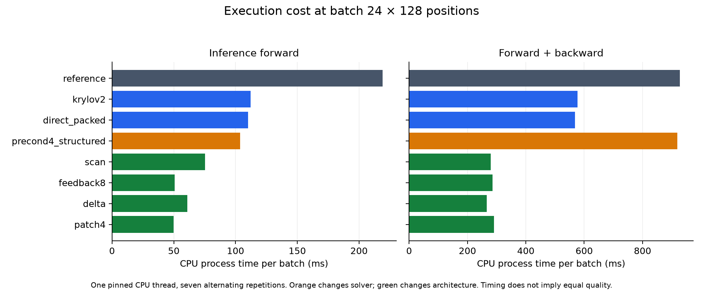
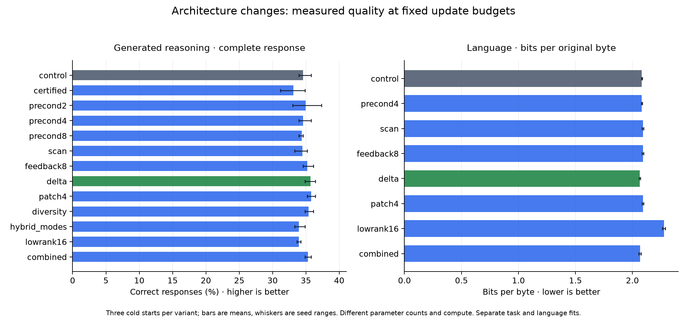
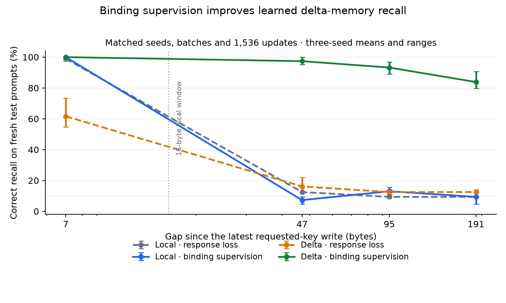

# REWT: implemented kernels and measured architecture improvements

The architecture now has dedicated execution paths and controlled learning
results, rather than only a list of proposed optimizations. This follow-up
completed **96 new fits**: 39 reasoning fits, 24 language fits at equal updates,
15 language fits at equal measured CPU budgets, and 18 memory fits. The final
memory ablation also reuses six frozen checkpoints. All declared
seeds and variants are included, including unsuccessful approaches.

The strongest demonstrated learning improvement is persistent delta memory
with explicit training of binding and write behavior. On the matched fresh
memory test it scores **95.75%**, versus
**54.95%** for the supervised local control.
The language improvement is modest, and the reasoning results do not establish
general multistep reasoning. Kernel speed, energy descent, learned memory and
answer accuracy are evaluated separately below.

## What was implemented

| Layer | Delivered change | Contract |
|---|---|---|
| Conditioning | Packed affine projections and precomputed GRU input maps | Same weights and mathematical function; rounding may differ |
| General refinement | Quadratic directional evaluation of all line-search trials | Full energy, arbitrary rounds, full supporting model, masking and coarse proposals |
| Fixed-step refinement | Curvature-bound steps; two-step reduced lift | Same trajectory only when the accepted step matches; larger steps change policy |
| Preconditioning | Arbitrary rounds in M mode coefficients | Different optimization geometry; trained and evaluated as a separate policy |
| Preparation | Analytic output elimination and latent Schur factorization | Same preconditioner and gradients with a smaller factorization |
| Observation path | Parallel affine scan and optional chunk feedback | Different recurrent architecture |
| Memory | Chunked delta writes and persistent matrix state | Learned retrieval beyond local attention; additional parameters |
| Update scheduling | Fixed causal patches and reused corrections | Fewer refinements; skipped positions have no current-energy guarantee |
| Mode/head experiments | Diversity penalty, shared/block modes, factorized output heads | Independently trained variants; no assumed quality preservation |
| Decode | Fixed-size ring, owned outputs, cache invalidation and whole-step CUDA graph | Fixed-weight GRU core only |
| GPU kernel | Full-row and output-tiled Triton mode-space refinement | Float32 inference only; PyTorch remains the training implementation |

The [design and derivations](DESIGN.md) explain each implementation. The code is
in `rewt/advanced_kernels.py`, `architecture.py`, `structured_solver.py`,
`ring_decode.py` and `triton_refine.py`. New paths are opt-in; the eight audited
archived checkpoints retain bitwise-identical default outputs.

## Why these are architecture-specific kernel improvements

For the anchor-relative core, displacement z has conditional energy
`E(z) = 1/2 z H zᵀ + Σ a_i cos((z Fᵀ)_i + phase_i)`.
At a stationary point, `H z = Fᵀ[a sin(F z + phase)]`. Therefore its displacement
lies in the M-dimensional span of `F H⁻¹`, even though the joint state has D
coordinates. Preconditioning exposes this directly:

```
B = F H⁻¹; G = F H⁻¹ Fᵀ
c_next = (1 - eta) c + eta a sin(c G + phase)
state = anchor + c B
```

The implementation performs every round on M coefficients and lifts once.
Ordinary finite-step gradient descent can contain transient directions outside
this span, so switching a checkpoint's solver is not an exact drop-in change.
The original two-step Krylov path, packed projections and structured preparation
provide the exact execution alternatives.

The other major cost is serial conditioning. A faster refinement kernel cannot
remove the dependency created when the previous refined recurrent state feeds
the next token. The scan variant changes that dependency so whole chunks can
use batched attention, conditioning and refinement. Chunk feedback restores an
explicit dependency at eight-byte boundaries. Delta memory adds persistent
content state without requiring a growing attention cache.

This also exposes a modeling limit: refinement currently optimizes a fixed
prefix-conditioned landscape. Additional rounds do not perform another read
of the input or invent a new reasoning operation. Their value must be learned
and measured, rather than inferred from decreasing energy.

## CPU execution

The final benchmark uses one CPU thread pinned to core 5, seven alternating
repetitions, and batch 24 × 128 positions. Values below are median process time.
Full wall-time samples, smaller batches, decode and preparation are retained in
[benchmark_final.json](benchmark_final.json). This run follows the first 81 fits
and precedes the separate compute-budget fits, with no concurrent study training
workers. The machine remains shared with unrelated work.

| Execution path | Forward CPU ms | Forward + backward CPU ms | Forward speed vs reference |
|---|---:|---:|---:|
| reference | 219.11 | 927.25 | 1.00× |
| krylov2 | 112.22 | 577.26 | 1.95× |
| direct_packed | 110.02 | 568.68 | 1.99× |
| certified_same_step | 107.61 | 944.98 | 2.04× |
| precond4 | 103.95 | 879.70 | 2.11× |
| precond4_structured | 103.66 | 918.98 | 2.11× |
| scan | 75.20 | 280.31 | 2.91× |
| feedback8 | 50.78 | 285.51 | 4.31× |
| delta | 60.86 | 266.41 | 3.60× |
| patch4 | 49.90 | 290.92 | 4.39× |


Most of the exact forward gain above comes from the previously implemented
Krylov reduction. Additional direct packing changes the large-batch forward
from 112.22 to
110.02 ms; it is not another 2× gain.

These are execution measurements, not equal-quality speedups. Scan, feedback,
delta and patches change the model. The reference already caches causal history;
the table does not compare against an artificially uncached baseline. Forward /
backward uses a logit-square objective, excluding optimizer and task auxiliary
losses. Preparation is included in sequence calls; decode measurements include
prefill and session setup.

The structured preconditioner factors **144 instead of 400 coordinates** at d=48.
Isolated preparation is **2.20×** faster forward and
**3.22×** faster including backward in this measurement. Its
forward values and every parameter gradient match the dense solve within the
recorded numerical tolerances, including nonuniform output precision.

This smaller factorization does not ensure a faster full backward pass: the
four-round structured model takes 918.98 ms
versus 879.70 ms for its dense version in the
full sequence benchmark. Preparation and end-to-end performance are distinct.

The general directional solver is workload-dependent. In the separate
[directional benchmark](directional_benchmark.json), core inference is 1.44×
faster when all backtracking trials are evaluated, but 0.83× as fast when the
CPU reference accepts its first small trial immediately. Both paths remain
available. Packing also does not improve every training shape; consult the
complete table rather than treating an inference win as a backward guarantee.

For prefill plus 32 decoded bytes, the CPU ring cache is approximately tied
with the dynamic cache. Its main purpose is fixed storage for graph capture;
these CPU measurements do not establish a decode acceleration:

| Batch | Prefix | Dynamic cache CPU ms | Ring cache CPU ms |
|---:|---:|---:|---:|
| 1 | 16 | 27.09 | 27.26 |
| 1 | 128 | 71.67 | 72.32 |
| 8 | 128 | 96.96 | 95.91 |




## GPU correctness and resource use

On NVIDIA GB10 with PyTorch 2.14 / CUDA 13, the full-row kernel passed 24
standalone checks and the ring/graph path passed ten decode comparisons,
including prefixes longer than the ring and 135 following bytes. Maximum
whole-step error was 3.44e-5 and audited greedy choices matched with TF32 disabled.
The tiled path passed **52 further GPU checks**, including whole-step graphs;
maximum error was below 3.6e-7 in that separate small-model matrix. The CPU
Triton interpreter also passed 64 formula/index checks.

At M=32, D=400 and four warps, the full-row kernel uses 158 compiled registers
per thread; the 64-coordinate tile uses 40. Tiling repeats the small recurrence
per output tile, so fewer registers do not automatically mean lower latency.
Compiler spill counts and shared memory are in [triton_resources.json](triton_resources.json)
and [triton_tiles.json](triton_tiles.json). These are not occupancy measurements.

The GPU was about 90% occupied by unrelated work and context allocation
occasionally failed under shared memory pressure. **No reliable GPU speedup is
claimed.** The delivered paths have numerical and graph-lifecycle validation;
uncontended latency tuning remains unmeasured. No custom backward, BF16/FP16,
dynamic-shape graph batching or other-GPU portability result is claimed.
See [PyTorch graph constraints](https://docs.pytorch.org/docs/2.14/notes/cuda.html#cuda-graphs)
and [Triton resource guidance](https://triton-lang.org/main/getting-started/tutorials/02-fused-softmax.html).

## Learned reasoning: all variants

Every arm has three cold starts, 1,024 updates, identical per-seed task batches
and supervision, 5,400 training identities and validation-selected checkpoints.
The test contains 162 semantic identities, each with familiar and withheld
wording: 324 prompts per model. These test identities exclude the 2,792 earlier
recorded test identities. The fresh training draw reuses 502 previous training
IDs and validation reuses three prior validation IDs; all new models start cold
and this study's own partitions are disjoint. See the [data audit](DESIGN.md).

The variant chosen by mean validation accuracy is **combined**. Test accuracy
requires both intermediate steps and the final answer to be correct.
It scores **35.29%**, versus
**34.57%** for the control; its paired
interval includes zero improvement.

| Variant | Test complete | Arithmetic | Rules | Recall | Δ vs control, paired 95% interval |
|---|---:|---:|---:|---:|---:|
| control | 34.57% | 0.00% | 5.56% | 98.15% | +0.00 pp [+0.00, +0.00] |
| certified | 33.13% | 0.00% | 4.01% | 95.37% | -1.44 pp [-2.47, -0.51] |
| precond2 | 34.98% | 0.00% | 7.72% | 97.22% | +0.41 pp [-0.82, +1.65] |
| precond4 | 34.57% | 0.00% | 6.48% | 97.22% | +0.00 pp [-1.03, +1.03] |
| precond8 | 34.36% | 0.00% | 5.86% | 97.22% | -0.21 pp [-1.13, +0.82] |
| scan | 34.47% | 0.00% | 3.40% | 100.00% | -0.10 pp [-1.13, +0.93] |
| feedback8 | 35.19% | 0.00% | 7.10% | 98.46% | +0.62 pp [-0.51, +1.95] |
| delta | 35.70% | 0.00% | 8.02% | 99.07% | +1.13 pp [-0.21, +2.47] |
| patch4 | 35.80% | 0.00% | 8.02% | 99.38% | +1.23 pp [-0.10, +2.67] |
| diversity | 35.39% | 0.00% | 7.72% | 98.46% | +0.82 pp [-0.31, +1.95] |
| hybrid_modes | 33.95% | 0.00% | 4.63% | 97.22% | -0.62 pp [-1.44, +0.00] |
| lowrank16 | 33.95% | 0.31% | 2.47% | 99.07% | -0.62 pp [-1.54, +0.21] |
| combined | 35.29% | 0.00% | 5.86% | 100.00% | +0.72 pp [-0.31, +1.75] |


Intervals use paired semantic-ID bootstrap samples, stratified by family/depth,
keeping both wordings together and averaging the three fixed trained seeds.
They do not estimate uncertainty over an unlimited population of training
seeds; exploratory multiple comparisons are not adjusted. Seed ranges,
parameters, training process times and all validation scores appear in
[RESULTS.md](RESULTS.md). Equal update counts are not equal compute or exact
parameter matching.

The family breakdown is essential: a one-third overall score can come mostly
from recall while arithmetic and multistep rules remain weak. These results do
not justify advertising more refinement rounds as stronger general reasoning.



## Does refinement improve the learned answer?

A separate post-training intervention removes all refinement rounds from nine
frozen checkpoints and evaluates the existing validation set. It does not
retrain, select a new policy, or inspect another test set.

| Trained variant | Normal validation accuracy | Zero-round accuracy | Changed generations |
|---|---:|---:|---:|
| control | 34.16% | 34.98% | 95/486 |
| precond4 | 34.36% | 34.57% | 161/486 |
| delta | 35.39% | 35.39% | 7/486 |


Refinement lowers response cross-entropy in these comparisons, but it does not
increase complete-answer accuracy. For the GRU models, removing refinement also
changes the later recurrent carry, so this is a full-policy intervention. The
delta variant changes only seven of 486 generations, supporting the narrower
finding that its learned observation/memory path dominates these outputs.

The validation-only geometry audit measures the frequency span and the output
correction relative to the anchor. Stable rank is sum(eigenvalues)/max(eigenvalue),
not the numerical matrix rank. Statistics below are three-seed means on the
same 18 validation prompts.

| Variant | Frequency stable rank | Correction / anchor logit RMS | Prompt argmax changed |
|---|---:|---:|---:|
| control | 5.60 | 0.00151 | 0.189% |
| precond4 | 4.54 | 0.00480 | 0.519% |
| precond8 | 5.66 | 0.00414 | 0.283% |
| scan | 6.64 | 0.00254 | 0.519% |
| delta | 6.28 | 0.00234 | 0.378% |
| diversity | 9.12 | 0.00100 | 0.047% |
| hybrid_modes | 6.76 | 0.00102 | 0.236% |
| combined | 2.87 | 0.00594 | 0.567% |


The diversity penalty raises stable rank from about 5.6 to 9.1, but its
complete-answer interval still overlaps the control. The correction is only a
small fraction of anchor-logit RMS in these trained models. Improving numerical
mode diversity alone does not make the residual responsible for correct answers.

The maximum audited round-energy increase across all 39 selected models is
**1.19e-07**. This tests
numerical descent, not answer correctness. At skipped patch positions,
**53.58%** of audited states have energy above the current anchor;
reusing a previous correction does not promise descent for a new token's energy.
See [trained_geometry.json](trained_geometry.json) and
[refinement_contribution.json](refinement_contribution.json).

## Language: a modest measured gain

The separate language screen trains eight variants across three seeds for
512 updates, or 1,572,864 BPE tokens per fit. Evaluation uses 256 distinct new
documents and divides negative log-likelihood by actual decoded target bytes.
The tokenizer is learned on the training partition only. Holdout source,
normalization, document exclusion and hashes are preserved.

The validation-selected variant is **delta**. Delta memory averages
**2.0650 bits/byte**, versus
**2.0825** for the control. Its paired difference
is **-0.0175**, with a document-bootstrap 95% interval
**[-0.0201, -0.0149]**, conditional on these three trained
seeds. All three seed differences favor delta memory. It has 257,537 parameters
versus the control's 256,096, so this is not an exact parameter-matched result.

Plain scan, chunk feedback and fixed patches are slightly worse on language.
Rank-16 output heads reduce parameters to 208,800 but worsen the score to
**2.2782 bits/byte**. That capacity trade is not
supported at this width and budget. Generated samples remain repetitive and
grammatically weak. This screen is much shorter than the earlier language
study and does not establish fluent generation or superiority to Transformers.

All 144 language continuations are retained. `inference.pt` copies include the
verified tokenizer metadata; original `best.pt` hashes and weights are unchanged.
See [document-level uncertainty](language/document_audit.json) and the full
language table in [RESULTS.md](RESULTS.md).

## Equal measured training compute

A separate declared screen compares the existing two-round Krylov control with
two-, four- and eight-round preconditioning, plus four-round structured
preparation. Each arm uses the same 256,096 parameters and three new seeds.
Each fit receives **150 measured training process seconds**, excluding
initialization, validation and checkpoint I/O, with at most one update overshoot.
Learning rate and four validation points follow consumed CPU budget. Faster
paths can therefore perform more updates, instead of receiving an identical
update count. All workers use one CPU thread on pinned performance cores.

| Solver | Mean updates | Mean training CPU seconds | Validation bpb | Test bpb | Test seed range |
|---|---:|---:|---:|---:|---:|
| precond2 | 117.0 | 150.565 | 2.8674 | 2.8856 | 2.8564–2.9096 |
| control | 112.7 | 150.355 | 2.8884 | 2.9067 | 2.8885–2.9306 |
| precond4 | 111.7 | 150.391 | 2.8955 | 2.9138 | 2.9058–2.9289 |
| precond8 | 104.7 | 150.534 | 2.9356 | 2.9545 | 2.9362–2.9737 |
| precond4_structured | 118.3 | 150.589 | 2.8564 | 2.8739 | 2.8612–2.8935 |


At this short budget, structured four-round preparation has the lowest mean
validation loss and scores 2.8739 test
bits/byte versus 2.9067 for the control. It completes
118.3 updates on average, versus
112.7. Eight rounds complete only
104.7 updates and score
2.9545 bits/byte. This supports treating refinement
depth as a compute allocation choice, not an automatic accuracy improvement.

The compute test uses 256 additional documents, excluding the entire earlier
256-document language test set. The study was declared after the first screen;
its new holdout was not used for model selection. This is a short CPU-budget
screen rather than a GPU compute comparison or long-run scaling result.
Process CPU seconds include batch preparation and training; they are not a
FLOP count and can still reflect shared memory bandwidth and clock conditions.
Fits run concurrently in declared order, with four workers and three final
structured fits; this is not a randomized hardware-isolation experiment. Use
the alternating execution benchmark to assess preparation cost separately.
See [the declared compute plan](equal_compute/plan.json), cumulative CPU traces
and [complete results](equal_compute/test_results.json).

## Persistent memory: the successful architectural change

The memory task uses eight keys and ten digit values. The requested key is
written twice with different values; other records are distractors. The model
must return the latest value from bytes alone. Training-only binding, copy and
write-gate labels do not enter inference. The longest trained far gap is 71
bytes; the test includes gaps of 95 and 191 bytes with a 16-byte local window.

The first response-loss-only recipe failed: delta memory averaged 34.46%, below
the local control's 54.17%. The longer binding-supervised follow-up reached
96.01%, but it changed both supervision and update budget. To isolate supervision,
the final ablation fixes seeds, batches, 1,536 updates, architecture and optimizer,
and evaluates all four arms on a third fresh 384-prompt test set:

| Memory | Training supervision | Mean accuracy | Accuracy at 191-byte gap |
|---|---|---:|---:|
| Local | Response only | 54.69% | 9.38% |
| Local | Binding + copy | 54.95% | 9.38% |
| Delta | Response only | 37.67% | 12.50% |
| Delta | Binding + copy + write gate | 95.75% | 83.85% |



This is evidence for learned persistent overwrite memory under a narrow grammar,
not open-ended recall or reasoning. Keys, values and syntax stay within the
training vocabulary; only bindings, distractors and lengths change. The delta
arm has 34,321 parameters versus 32,752 in the local arm. The experiment identifies
the combined training recipe, not the individual causal contribution of each
auxiliary loss. It also demonstrates that adding a theoretically capable memory
state without teaching its writes can make performance worse.

The recurrence follows the delta-rule family described in
[DeltaNet](https://arxiv.org/abs/2406.06484). The local implementation uses a
differentiable triangular chunk solve, not an imported optimized DeltaNet kernel.
The observation scan follows the affine-recurrence idea in
[Were RNNs All We Needed?](https://arxiv.org/abs/2410.01201); published results from
those papers are not attributed to this small model.

## Recommended defaults and remaining research

For existing checkpoints, retain their solver and use the validated Krylov,
packing and fixed-cache execution options where measured beneficial. Use the
structured factorization when choosing the separately trained preconditioned
policy. Keep the CPU early-exit reference available. GPU graphs and tiled Triton
are opt-in until uncontended end-to-end timing establishes their useful shapes.

For a new architecture, persistent memory with explicit write/read training has
the strongest evidence here. The scan exposes useful batching, but its language
tradeoff should remain visible. Keep full-rank output heads at this size. Treat
fixed patches as an experimental latency/quality trade; they do not retain a
per-token energy guarantee. Do not promote extra rounds or diversity penalties
as reasoning improvements without complete-answer gains.

The next modeling target is the contribution of refinement itself: richer
context-dependent residual geometry or another causal memory read per round,
paired with a training objective that rewards actual answer correction. Another
read changes the frozen conditional objective and therefore needs a new descent
contract; it is not a free extension of the current kernel. A learned patch
boundary likewise needs causal boundary supervision and separate quality tests.
These are research directions, not implemented or validated claims in this run.

## Verification and reproducibility

**198 REWT tests passed.** Exact-path checks cover values, every parameter
gradient, causality, awkward chunk boundaries, ring wraparound, graph-state
restoration, output ownership, stale-cache rejection, structured solves and
delta overwrites. Eight archived defaults remain bitwise equal; 486 prompt/path
pairs have identical generated bytes on the audited exact execution paths.
All 13 training variants replay outputs, gradients and updated weights bitwise
against the frozen source for three optimizer updates.

The delivered source archive, data/checkpoint checksums, all plans, optimizer
traces, predictions, failures and measurements are preserved. See
[reproduction instructions](REPRODUCING.md), [complete tables](RESULTS.md),
[machine-readable summary](summary.json), [artifact manifest](manifest.json),
and [source archive](final_source.tar.gz). No archived checkpoint was overwritten
or new architecture silently substituted into a legacy model.
