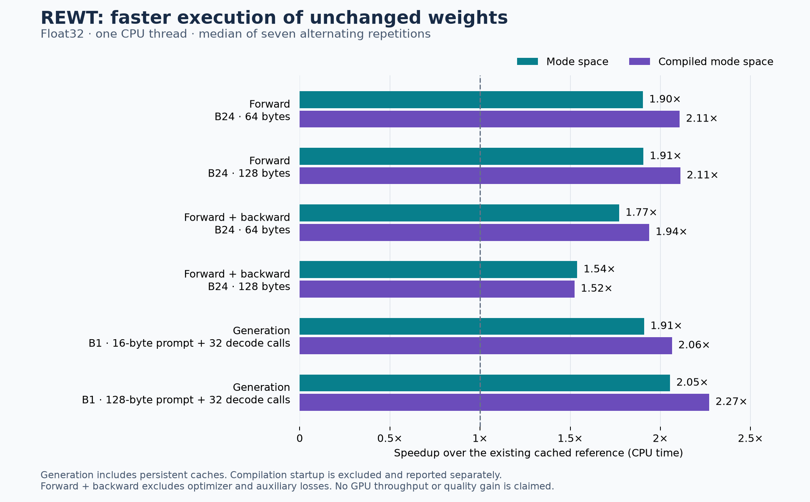

# REWT: architecture-specific kernels and the next architectural changes

The most useful discovery is an algebraic one: the current two-round energy
solver only needs a 64-dimensional subspace of its 400-dimensional workspace.
An optional implementation now exploits that fact, with matching predictions,
parameter gradients and generated bytes in the checks below. It adds no learned
parameters and does not retrain or replace the saved models.

The larger architectural opportunity is to separate an efficiently parallelizable
observation/memory backbone from the energy workspace used for reasoning. Merely
writing a faster softmax will not remove the present byte-by-byte dependency.

## What is implemented and measured

- `rewt/kernels.py`: two-round mode-space refinement, vectorized backtracking,
  and differentiable preparation of the small mode matrices once per forward.
- `EnergyConfig.refinement_backend='krylov2'`: opt-in execution specialization;
  `model.compile_refinement()` compiles the complete refinement region.
- `rewt/decode.py`: explicit inference sessions retaining projected observations
  and mode matrices across generated bytes, with model-change invalidation.
- `scripts/sample_rewt.py`: `--refinement-backend krylov2`, `--decode-cache`,
  and optional `--compile-refinement`.

This is architecture-specific algebra implemented in PyTorch, with compiler
generated CPU/CUDA kernels. A handwritten Triton implementation has not been
added. Ordinary linear algebra, convolution and attention already have usable
kernel implementations; the missing part was efficient execution of this joint
energy and its recurrent schedule. PyTorch also exposes optimized attention
backends through [scaled dot-product attention](https://docs.pytorch.org/docs/2.14/generated/torch.nn.functional.scaled_dot_product_attention.html).

Measured on the unchanged broader-task checkpoint, float32, one CPU thread,
seven alternating timing repetitions. The reference already uses the previous
within-forward history cache and CPU backtracking early exit. These improvements
are additional to that implementation, but should not be multiplied by the
older report's speedups from a different workload/checkpoint.

| Workload | Reference CPU ms | Mode-space CPU ms | Compiled CPU ms | Compiled speedup |
|---|---:|---:|---:|---:|
| B1, 32 bytes, forward | 27.107 | 13.516 | 11.823 | 2.29× |
| B1, 32 bytes, forward + backward | 97.487 | 47.578 | 45.275 | 2.15× |
| B24, 64 bytes, forward | 99.199 | 52.125 | 47.072 | 2.11× |
| B24, 64 bytes, forward + backward | 329.503 | 185.984 | 169.984 | 1.94× |
| B24, 128 bytes, forward | 178.435 | 93.616 | 84.510 | 2.11× |
| B24, 128 bytes, forward + backward | 937.449 | 609.170 | 615.267 | 1.52× |

At 128 bytes the uncompiled mode-space path is slightly faster for training
(1.54×); compilation is not an automatic win. Forward/backward timings exclude
optimizer updates and training-only auxiliary losses. No new end-to-end training
cost or Transformer speed comparison is claimed.

| B1 generation workload | Reference CPU ms | Mode-space + persistent cache | Compiled + persistent cache | Compiled speedup |
|---|---:|---:|---:|---:|
| 16-byte prefill + 32 decode calls | 52.854 | 27.676 | 25.598 | 2.06× |
| 128-byte prefill + 32 decode calls | 157.712 | 76.789 | 69.437 | 2.27× |

The continuation alone improves by 2.22× and 2.13× in these two compiled cases.
Persistent observation caching alone improves total generation by only 1.05× and
1.02×. Retaining the newly introduced mode matrices is an important part of the
combined improvement. Decode measurements consume exactly 32 emitted bytes,
including the last one; they exclude response checkers and newline stopping.

Cold first calls are separate: approximately 11.68 seconds for B1 inference,
8.52 seconds for B1 forward/backward, 5.34 seconds for B24 inference and 8.42
seconds for B24 forward/backward. Each includes the ordinary first execution
as well as compiler work. Longer sequence lengths reuse the same inner kernel.
For occasional short CLI calls, the uncompiled backend avoids that startup cost.
Compilation uses `fullgraph=True`; this requires one captured graph for the
selected function, rather than silently accepting graph breaks.
[PyTorch compile documentation](https://docs.pytorch.org/docs/2.14/generated/torch.compile.html).



Raw samples, wall times, compilation warmup, hashes and parity errors are in
`benchmark.json`. The host is aarch64 with Cortex-X925/Cortex-A725 CPU cores,
PyTorch 2.14.0+cu130. The GB10 was 93–94% busy with other work. A small CUDA
correctness check passed, but there is **no GPU throughput result** here.

## Why this reduction works

The warmed CPU profile attributes roughly half of reference prefill time to
energy and gradient evaluation, and about one quarter to conditioning. After
the reduction, conditioning accounts for roughly 40% of the profiled forward
path. Retrieval itself is a much smaller fraction in these short-history CPU
workloads. These are instrumented stage measurements, not GPU bottleneck claims.

Let `z = state - anchor`, let `F` contain the learned Fourier directions, and
let `H` be the Hessian of the complete quadratic on the centered-output domain.
For the current core configuration:

```text
E(z) = 1/2 zᵀ H z + Σ_k a_k cos((F z)_k + φ_k)
∇E(z) = H z - Fᵀ [a ⊙ sin(F z + φ)]
z₀ = 0
```

`H` includes the diagonal precision, recurrent–attention agreement, and decoder
compatibility. It is not replaced by a diagonal approximation. `F` and `H` are
fixed while a forward call uses fixed learned weights; amplitudes and anchors
vary with each observed prefix.

The first update lies in `range(Fᵀ)`. The second lies in
`range([Fᵀ, H Fᵀ])`. Backtracking changes scalar step lengths and does not
change those spans. The checkpoint has 32 modes and 400 workspace coordinates;
the measured ranks are 32 and 64 respectively. This is an exact-arithmetic
property of its finite two-step solver, not a learned compression or truncation.

Prepare the four small matrices `K_j = F H^j Fᵀ`, for `j=0..3`, once per forward.
Both rounds then operate on mode coefficients, lifting the final update into
the full workspace once. Preparation retains autograd through the frequencies,
precision and decoder weights. It is recomputed after every training forward;
training never reuses a stale parameter-dependent cache.

Backtracking uses the exact identity

```text
E(z - ηg) = Q(z) - η (H z)ᵀg + 1/2 η² gᵀH g
            + Σ_k a_k cos((F z + φ)_k - η(F g)_k).
```

The scalar quadratic and projected direction are reused for all four candidate
step sizes. The kernel picks the largest passing step, equivalent to the first
passing attempt in the reference loop, or KEEP if none passes. A rejected
nonfinite trial retains the anchor. No host Boolean decides the line search.
Floating-point reassociation means the optimized path is numerically equivalent
within checked tolerances, not bitwise identical.

The optimized `energy_calls` metric counts vectorized scalar energy evaluations,
including the returned final energy: eleven per token for two rounds and four
attempts. These are not eleven calls to the old full-workspace energy function.
Runtime, rather than that counter alone, measures the savings.

The specialization requires the Fourier core, anchor-relative quadratic and
wave geometries, zero initial carry, all-mode scheduling and no adaptive
halting. Other round counts, initial noise and state/output interventions use
the reference solver. Unsupported architectural configurations are rejected
explicitly. The forecast/diffusion/specialist model continues to use its original
solver; this speedup is not a claim about that larger model.

## Verification and limits

- **144 REWT tests passed**, including double-precision state, energy and every
  participating parameter-gradient comparison; rejected steps; nonfinite
  candidate handling; optimizer updates; causal prefixes; chunk boundaries;
  positional wrapping and history rollover.
- **648 existing validation prompts / 10,718 generated bytes** agree exactly
  between the frozen original implementation and mode-space decoding with
  persistent caches. No closed-test set was used to choose or tune a model.
- **Eight saved checkpoints** retain bitwise-identical default-path logits and
  final joint states against the source snapshot taken before these edits.
- In the CPU float32 benchmarks, the largest logit difference is `4.58e-5`,
  the largest parameter-gradient difference `3.70e-6`, and all next-byte argmaxes
  agree. The small compiled CUDA forward/backward check also passes.
- Checkpoint and inference-weight hashes are unchanged. Cache invalidation tests
  cover parameter/buffer updates, dtype changes, training mode and configuration
  replacement. Writes through `.data` bypass PyTorch version tracking and are
  unsupported by the session cache.

These checks establish execution parity, not better reasoning. The earlier
arithmetic, longer rule-chain and prose weaknesses remain. No new model was
trained here. Float16/bfloat16 behavior has not been validated; reducing energy
comparison precision should be treated as a separate experiment.

## Further improvements, in priority order

### 1. Certified steps can remove the remaining line search

**Evidence from this checkpoint, not yet enabled as an execution policy.**
Because `|a_k| ≤ 0.5/√M`, a prefix-independent curvature bound is

```text
∇²E(z) ⪯ H + (0.5/√M) FᵀF
L = λ_max(H + (0.5/√M) FᵀF).
```

The geometry audit obtains `L = 2.3466444`. The descent lemma guarantees a
strict decrease for a nonzero gradient when `0 < η < 2/L ≈ 0.852281`, in exact
arithmetic. The trained step is `0.25`. Thus backtracking is mathematically
redundant for finite states of these fixed weights. This certificate is broader
than observing that a batch happened to accept its first trials.
The worst-case lower curvature bound is negative (`-0.3262`), so this audit
does not certify convexity or a unique minimum.

A certified two-round kernel would need only `F Fᵀ` and `H Fᵀ`, two sine
evaluations, and the final lift. It could omit the cosine candidate bank and
the higher-order Gram matrices. Build the certificate with a conservative
numerical margin; invalidate it whenever weights change; keep float32
comparisons or a checked fallback near numerical stationarity. The eigenvalue
audit is numerical, not interval arithmetic. Increasing the learned step size
because the bound permits it would change predictions and needs a new quality
study. A training optimizer step also requires recertification or a parametrized
bound. This optimization has a concrete mathematical basis but no measured
implementation speedup yet.

### 2. Preconditioned mode-space refinement keeps arbitrary rounds in 32 coordinates

**Derived and algebraically checked; a different solver that requires training
and quality evaluation.** On the admissible centered domain, define

```text
B = H⁻¹ Fᵀ,  G = F H⁻¹ Fᵀ,  z = B c
E(Bc) = 1/2 cᵀG c + Σ_k a_k cos((G c)_k + φ_k).
```

Every stationary point of the full energy lies in this 32-dimensional space.
Unlike the ordinary gradient Krylov space, it need not grow with the round
budget. Preconditioned gradient descent induces

```text
c_next = (1 - η)c + η a ⊙ sin(G c + φ).
```

Twelve rounds were checked against full-space preconditioned updates using the
checkpoint's actual operators and synthetic amplitudes: state error below
`9e-17`, energy error below `2e-16`, and no energy increases. This checks the
identity, not learned accuracy or convergence to the global optimum.

The nonzero quadratic eigenvalues span approximately `0.8525..1.4622`
(condition number `1.715`). Therefore this is primarily a compact solver and
kernel opportunity, not a cure for severe conditioning. Preconditioned curvature
is bounded by about `2.3275`, similar to the present bound. Use a differentiable
solve with the output gauge removed, exploit the diagonal-plus-linear-residual
structure instead of materializing a dense inverse, and include setup cost in
benchmarks. At many rounds the per-round work becomes small `M×M` products;
at two rounds, preparation may outweigh any savings. Train it as its own arm.

### 3. Separate observation memory from refined reasoning state to unlock scans

**Architectural change; highest potential for training parallelism.** The current
GRU proposal and, with the convolution enabled, attention query both depend on
the previous refined recurrent state. Therefore token `t+1` cannot be prepared
until token `t` finishes refinement. Replacing `GRUCell` with an optimized scan
alone does not remove that dependency.

Introduce an observation state `h_t = a_t ⊙ h_(t-1) + b_t`, with coefficients
computed from causal observed features rather than the preceding refined state.
Compose transitions associatively, produce anchors/queries from this backbone,
and batch energy refinement over positions. Parallel selective recurrences and
matrix-friendly state-space decompositions are relevant precedents in
[Mamba](https://arxiv.org/abs/2312.00752),
[Mamba-2](https://arxiv.org/abs/2405.21060) and
[minimal GRUs](https://arxiv.org/abs/2410.01201).

This changes the model's feedback path. It may lose some of the multi-step
behavior that depends on a refined state influencing the next query. Compare
three explicit variants: fully independent observation backbone, feedback only
between causal chunks, and the current exact recurrent baseline. A block's
refined summary must only affect later bytes; using its final summary to predict
earlier bytes inside the same block would leak the future. This proposal is an
inference from the dependency graph, not evidence that a scan model will retain
REWT's task performance.

### 4. Add an energy-compatible long-term associative memory

**Architectural extension with existing kernel candidates.** Preserve the local
softmax window and add an observation-only matrix memory, for example

```text
S_t = S_(t-1) + β_t [v_t - S_(t-1) k_t] k_tᵀ.
```

That update is a gradient step on a local squared retrieval error with respect
to ephemeral memory state. All learned model parameters can remain fixed at
inference. Keys and values come only from supplied bytes; candidate forecasts
must not write into this observed-memory channel. Read this long-term state
alongside local retrieval and let a learned gate choose how to use both.

Delta-rule sequence kernels are directly relevant: the
[DeltaNet paper](https://arxiv.org/abs/2406.06484) develops a parallel training
algorithm, and [Flash Linear Attention](https://github.com/fla-org/flash-linear-attention)
provides implementations for several such recurrences. They do not implement
REWT's whole joint energy, but could serve this separable memory component.
Finite matrix capacity and interference can hurt exact recall; keep the local
window and test many keys, overwritten values, long gaps, reordered facts and
multiple simultaneous queries. Current fixed-key digit recall is too narrow
to establish general associative-memory quality.

### 5. Make the decode path suitable for a whole-step GPU graph

**Engineering work after an uncontended GPU profile.** The new session caches
the expensive values but still concatenates rolling keys/values and raw history,
uses Python position counts, and performs byte-range validation on every call.
On CUDA, Python Boolean conversion of those validation tensors synchronizes the
host. Caching alone does not make this a fully captured decode loop.

Use fixed-size ring buffers for K/V and convolution history, a validity mask
for the unfilled prefix, and a device-side write position. Separate external
input validation from a trusted internal step consuming an argmax-produced byte.
Capture the entire fixed-shape step, including conditioning and refinement.
Respect storage lifetimes and mutation rules described by
[PyTorch CUDA Graph Trees](https://docs.pytorch.org/docs/2.14/user_guide/torch_compiler/torch.compiler_cudagraph_trees.html).

Also pack shared-input projections before writing custom replacements for every
operator. In this checkpoint, the first prior layer, output prior and amplitude
projection all consume the same 144-value feature vector and produce
`736 + 256 + 32 = 1024` outputs. One packed affine projection can replace those
three calls while retaining separate learned tensors and their gradients.
Prepare the packed weights once per forward, or per validated inference session.
The GRU's input-only affine term can similarly be precomputed over observed
positions; its hidden-state affine term remains sequential. Both are exact
execution opportunities, but neither speedup has been measured here.

For a handwritten GPU kernel, start with the reduced mode computation: a small
row of mode coordinates, the projected phases and four candidate steps can be
kept together, rather than repeatedly writing full 400-coordinate candidates.
Tune by batch size and mode count, and measure register spills and occupancy.
The general benefit of fusing reductions and intermediate operations is
illustrated by [Triton's fused-softmax tutorial](https://triton-lang.org/main/getting-started/tutorials/02-fused-softmax.html).
One tiny sequence still offers little GPU parallel work; batching and launch
overhead matter as much as arithmetic throughput. No numerical GPU speedup is
predicted from the CPU result.

### 6. Extend the directional kernel to the full support architecture

**Compatible mathematics, unimplemented generalization.** The directional
energy identity above also applies when quadratic coefficients are conditioned
on routing, as long as that conditioning is frozen during a line search. Compute
the full quadratic's direction curvature once per round, then evaluate all
candidate step sizes in Fourier coordinates. This can support arbitrary round
counts, initial carry/noise, and the communication/specialist residuals without
recomputing their linear maps for every candidate.

The stronger once-per-forward Krylov preparation does not transfer directly:
the full model's routing changes its quadratic operator by prefix. A separate
architectural option is a fixed learned compatibility operator with routing
affecting anchors/amplitudes, or a fixed operator plus small low-rank conditional
updates. Both change the model and need a controlled quality comparison. Given
the earlier full-model instability, first verify finite gradients and useful
forecast/specialist contributions before paying to optimize every component.

### 7. Improve mode allocation and schedule expensive reasoning less often

**Quality and efficiency hypotheses, not measured gains.** The frequency matrix
has actual rank 32, but its stable rank `||F||_F² / ||F||_2²` is only `4.665`.
This indicates uneven directional strength, not that 27 modes can simply be
deleted. Test a gentle diversity penalty or shared-plus-block-specific modes
before increasing mode count. Doubling modes makes the dense mode Gram products
roughly four times larger, so measure quality per CPU/GPU second rather than
assuming more modes are free.

The 256 logits occupy 64% of the present joint workspace. The implemented lift
already avoids repeatedly manipulating them inside the two-round solver.
For a larger vocabulary, low-rank output correction or the preconditioned
formulation is preferable to carrying every logit through every round. Dropping
output participation from the waves would change the energy; a quadratic-only
Schur elimination is not valid for the current nonlinear output coupling.

A second avenue is a cheap causal byte encoder/decoder around less frequent
latent energy updates. Learned byte patches are an established architectural
direction in [Byte Latent Transformer](https://arxiv.org/abs/2412.09871); that
paper's scale and results should not be extrapolated to this small model. For
REWT, start with short fixed causal chunks, then learn prefix-only boundaries.
Keep within-chunk next-byte prediction causal and evaluate how delayed global
feedback affects rule chains. This targets the number of serial refinement
invocations, which a faster kernel by itself cannot remove.

## Recommended experiment order

1. Use the checked mode-space backend and persistent decode cache as the faster
   execution baseline. Keep cold compilation costs visible.
2. On an idle GPU, profile the entire decode step, then implement the fixed-size
   cache/graph path and decide whether custom Triton work is warranted.
3. Build a guarded certified-step inference arm, compared to the existing
   two-round outputs and full-energy audits across multiple saved checkpoints.
4. Train the 32-coordinate preconditioned solver against the current solver at
   both equal updates and equal measured compute. Test 2/4/8 refinement rounds.
5. Run a three-seed comparison of current recurrent feedback, scan-compatible
   observation memory, and chunk-boundary feedback. Add longer associative-memory
   tests before choosing a matrix-memory replacement.

Use fresh declared task identities for model selection and a new unopened test
partition for the resulting architectural study. Preserve the previous closed
tests and checkpoint lineages. Measure arithmetic/rule complete responses,
recall under interference, language loss and actual generated prose, as well as
time, memory, startup cost and refinement energy. Lower energy alone is not a
certificate of a correct answer.

Commands and artifact descriptions are in [REPRODUCING.md](REPRODUCING.md).
