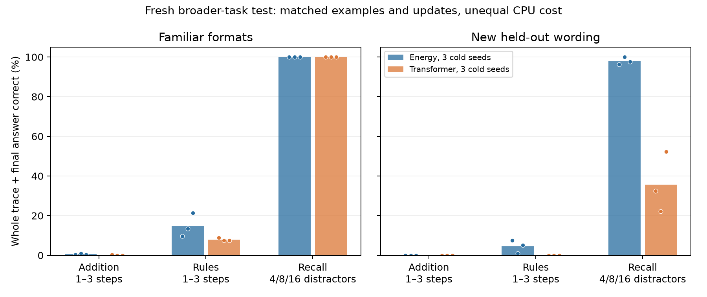

# Broader retrieval and CPU polish, October 10, 2026

The native Fourier joint-energy model now recalls the requested digit on all 432 fresh recall prompts, including new wording, random placement of the key, and 4, 8 or 16 distractors. Caching observed encodings also reduces redundant forward work without adding inference parameters. Extended arithmetic remains weak, and this follow-up does not improve the earlier incoherent story generation.

## Fresh broader-task evaluation

The frozen test contains 1,296 prompts for 648 distinct semantic problems, each presented once in a familiar format and once with new held-out wording. Training, validation and test identities are disjoint; test identities exclude the earlier declared tests. Five training wordings, two validation-only wordings, and two new test-only wordings are separated. All prompts and responses fit the shared 128-byte window.

Arithmetic starts at 0–63 with addends 1–63, and includes one to three additions. Every fresh one-addition test case has at least one operand above 31 because the earlier low-range test identities were already opened. Rule tasks contain one to three applications with shuffled facts and distractor edges. Recall uses one key `K` with a value from 0–9 among `X` distractors; its position varies. This is bounded digit retrieval, not arbitrary-key or long-document retrieval.

Correct requires the whole generated trace and final answer to match. The model receives only raw prompt bytes; expected answers, numeric heads, task payloads and symbolic checking are outside inference. Checkpoints and Transformer learning rate were selected on validation before fresh generation.

| Selected warm model | Familiar format, 2 rounds | New wording, 2 rounds | Familiar format, zero rounds | New wording, zero rounds |
|---|---:|---:|---:|---:|
| 1 addition | 13/72 (18.1%) | 1/72 (1.4%) | 7/72 (9.7%) | 5/72 (6.9%) |
| 2 additions | 2/72 (2.8%) | 0/72 (0.0%) | 0/72 (0.0%) | 0/72 (0.0%) |
| 3 additions | 0/72 (0.0%) | 0/72 (0.0%) | 0/72 (0.0%) | 0/72 (0.0%) |
| 1 rule application | 48/72 (66.7%) | 8/72 (11.1%) | 25/72 (34.7%) | 13/72 (18.1%) |
| 2 rule applications | 30/72 (41.7%) | 16/72 (22.2%) | 19/72 (26.4%) | 10/72 (13.9%) |
| 3 rule applications | 11/72 (15.3%) | 2/72 (2.8%) | 1/72 (1.4%) | 1/72 (1.4%) |
| Recall, 4 distractors | 72/72 (100.0%) | 72/72 (100.0%) | 72/72 (100.0%) | 70/72 (97.2%) |
| Recall, 8 distractors | 72/72 (100.0%) | 72/72 (100.0%) | 72/72 (100.0%) | 72/72 (100.0%) |
| Recall, 16 distractors | 72/72 (100.0%) | 72/72 (100.0%) | 70/72 (97.2%) | 62/72 (86.1%) |

The selected warm checkpoint completes 563/1,296 responses (43.4%), compared with 26.8% for its previous parent and 38.5% when refinement is disabled in the same new weights. Valid formatting is 99.8%; correct formatting is therefore much more frequent than correct reasoning.

The warm continuation carries the previous task-training lineage and adds the broader curriculum. Its comparison with the old parent measures a continuation and changed training recipe, rather than an isolated architectural effect. The zero-round policy is a same-weight counterfactual, not an independently trained competing model.

A paired semantic-ID bootstrap gives a conditional 95% interval of 14.5–18.8 percentage points for the gain over the parent, and 3.4–6.5 points for refinement's gain. Both wordings stay together and identities are resampled within family/depth. These intervals cover test-sample uncertainty for fixed checkpoints, not training-seed or selection uncertainty.

[Frozen test plan](test/plan.json), [all nine measurements and fixed-weight checks](test/results.json), [every selected warm response](test/selected_warm_outputs.jsonl), [audited counts, uncertainty and fit ledger](summary.json).

## Three cold seeds and the Transformer control

All cold models start from random weights. Within each seed, energy and Transformer arms use identical examples, rendering randomness, supervision targets, response-token budgets, 3,072 charged updates and batch size 24. Inference parameter counts are 256,096 and 256,240, respectively, differing by 0.056%. All three energy seeds complete more of these fresh tasks than their paired Transformer controls.

| Cold architecture | Seed 2101 | Seed 2102 | Seed 2103 | Mean complete accuracy | Mean training CPU seconds |
|---|---:|---:|---:|---:|---:|
| Energy | 35.6% | 35.9% | 37.4% | 36.3% | 2,479.1 |
| Transformer | 23.6% | 21.6% | 26.6% | 23.9% | 363.5 |

The cold energy gain mainly comes from transfer in retrieval: new-wording recall is 96.3%–100.0% across its seeds, versus 22.2%–52.3% for the Transformer. Both architectures reach 100% familiar-format recall. Arithmetic is near zero for both cold controls, and cold rule following remains weak.



[Exportable figure](cold_seed_results.pdf). Bars show the mean of three independent training seeds; points show each seed. Both wording panels use the same 648 semantic problems, and these are small synthetic tasks.

Energy training uses about 6.82 times as much CPU at the common update budget. Generating and checking all 1,296 prompts uses a mean 17.44 CPU seconds for the cold energy models and 8.54 for the Transformer. These generation measurements include prefill, generated bytes, and checking; output lengths differ because generation stops at newline or the declared limit. The separate forward-only profiles use the exact same single-row 32-byte prefix, padded with spaces. This Transformer implementation recomputes its prefix during decoding.

The Transformer has a two-rate validation screen, using mean validation accuracy across three seeds. Its chosen main/continuation rates are 0.003/0.0015; energy uses 0.001/0.0005. Architecture-specific hidden tensors and auxiliary heads differ: 13,318 additional training-only parameters for energy and 21,222 for Transformer. Energy bounds credit through carried latent states to 32 tokens while keeping its 128-byte forward memory; Transformer backpropagates through its full window. This is a shared-label, matched-update comparison with different optimizer presets, representations and compute. It does not establish superiority over well-tuned or larger Transformers.

## Execution and learning changes

The causal observed bank is encoded once per forward call. Memory retrieval can use the same cached keys and values with split heads, and position-memory models add the correct observed positions before encoding. Cache tests cover causality, chunked continuation, rollover and every parameter gradient. Archived defaults remain available, and caching adds no inference parameters.

| Preserved-weight CPU workload | Uncached median | Cached median | Speedup |
|---|---:|---:|---:|
| Forward, batch 24 × 64 bytes | 208.84 ms | 102.82 ms | 2.03× |
| Forward + backward, batch 24 × 64 bytes | 830.11 ms | 469.13 ms | 1.77× |
| Actual short-answer generation, 16-byte addition prompt | 30.59 ms | 28.94 ms | 1.06× |

These are local single-thread CPU measurements. The batch benchmark uses five measured repeats and no optimizer updates or auxiliary losses. It records zero logit difference, identical argmax and identical energy-call counts. The short-generation benchmark uses five alternating measured repeats after warmup; both policies generate exactly `steps=42;ans=42`. Continuation-only timing is effectively unchanged. The cache is per-forward and does not persist inference keys/values across decode calls; the 2× forward measurement should not be described as 2× decoding.

[Batch measurements](memory_benchmark.json), [actual generation measurements](generation_benchmark.json), [exact executed generation benchmark source](generation_benchmark_script.py).

The separate analytic-gradient compilation probe gives a modest 1.09× forward/backward gain on batch 24 × 32 bytes, with 23.85 seconds of warmup wall time. It checks logits, all parameter gradients and unchanged weights. The training trials remain eager; compilation is not included in their speed or accuracy claims. [Compilation measurement](compile_benchmark.json).

Learning now uses five prompt formats and random placement of requested recall facts. Causal fact pointers, observed numbers, running results, copy targets and remaining-step targets are training supervision only. The completion continuation gives syntax a weight of 4, the final newline a weight of 32, and adds a zero-remaining-steps label at the final answer. It is applied to both architectures. Four warm cases compare head count and existing wave coordinates; validation selects two heads with anchor-relative waves. Auxiliary heads are absent from the inference model.

## Run the selected models

The broader checkpoint has 256,096 inference parameters and fixed inference weights. Its exact path is:

```text
/home/kt/Documents/EnergyTransformer/runs/rewt_polish_20261010_v2/termination/warm_heads2/best.pt
```

Checkpoint SHA-256:

```text
2b184d2c5213345ecde465b0cbb5a4da11b090d04eb8d6ba90f6309c0949b09d
```

From the repository root:

```bash
OMP_NUM_THREADS=1 OPENBLAS_NUM_THREADS=1 MKL_NUM_THREADS=1 \
  .venv/bin/python scripts/sample_rewt.py \
  --checkpoint runs/rewt_polish_20261010_v2/termination/warm_heads2/best.pt \
  --prompt $'walk V 2:B>A;V>Q;G>B;Q>R=?\n' \
  --greedy --stop-newline --max-new 40 --cache-history
```

The actual sampler generates `steps=Q,R;ans=R`. This is an illustrative validation example, selected for display. The saved CLI examples also include successful recall among 16 distractors and a failed arithmetic answer, with full raw outputs. [Actual CLI samples](validation_cli_samples.json).

The narrower one-addition checkpoint remains available at `runs/rewt_learning_20261010/binding/aligned/best.pt`. Its earlier 94.7% fresh arithmetic result concerns inputs 0–31 and familiar formats. The broader checkpoint does not supersede that arithmetic result. Its cached sampler still generates `steps=42;ans=42` for the checked `19+23` example using the older weights. [Actual cached one-step CLI execution](legacy_cached_cli_sample.json), [earlier bounded results](../rewt_learning_20261010/FINDINGS.md).

## Verification and limits

All 100 REWT implementation tests pass on the frozen package source. The additional checks cover cached multi-head/position memory, causal Transformer training details, semantic partitions and annotations. Full training smokes cover all 13 continuation cases; evaluation smokes exercise all nine policies on validation prompts before opening the fresh test.

All nine scored policies retain identical state-dictionary hashes before and after generation and profiling, and their checkpoint files remain unchanged. Every audited accepted update is nonincreasing in the complete conditional energy. That property verifies energy descent, not answer correctness. Six archived core/neural/full checkpoints retain bitwise-equal default predictions, and their files still match their original hashes. [Archived-checkpoint parity](legacy_parity.json), [frozen test checks](test/results.json), [completed source, weight, data and documentation audit](completed_verification.json).

The completed main and continuation fits use 16,390.9 aggregate training CPU seconds and 1,952.4 validation CPU seconds. These totals count shared warm source fits once and preserve both Transformer screen rates. They exclude the earlier warm lineage, test scoring, data preparation, benchmark/compilation probes, smoke runs and interrupted harness work; they are not project wall time. Individual costs, chosen steps, charged budgets and hashes remain in [the ledger](summary.json), [main fit results](curriculum/results.json), and [continuation results](termination/results.json).

All main and continuation losses remain finite at the declared budgets; saved validation checkpoints protect against a worse continuation. Extended arithmetic, three-step rule traces and wording transfer for rules are still poor. Story fluency is unchanged and remains limited in the earlier language study. The improvement is faster model execution and more reliable bounded native retrieval, with a stronger replicated comparison and explicit remaining failures.

[Reproduction commands and workload scope](REPRODUCING.md).
