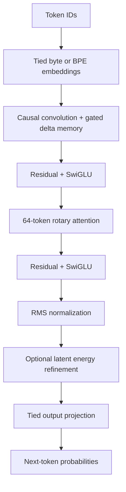

# Streaming REWT: measured improvements against matched Transformers

This is an opt-in architecture experiment, prompted by the goal of making the
project competitive across quality and cost. It does not replace the earlier
REWT checkpoints or the separate structured rule-reasoning head. Every model in
this study is an autoregressive language model: inference sees token IDs and
fixed learned weights, without a parser, external solver, or correctness oracle.

## Architecture

All four arms use two residual blocks, width 64, four heads, RMS normalization,
SwiGLU feedforward layers, and a shared input/output embedding matrix. Full and
window attention use rotary positions and PyTorch scaled dot-product attention.
The window control has the same 64-token window used by the hybrid. All four
can generate text using the same sampling interface.

The hybrid's first block uses a three-position causal depthwise convolution,
followed by four independent 16-by-16 persistent delta-memory matrices. Its
second block uses window attention. The energy variant then adjusts the final
64-dimensional hidden state before the tied output projection. It does not
optimize all 256 output scores jointly, and it does not perform the explicit
repeated fact reads of `ReadReviseReasoner`.

The Transformer feedforward width is 162; the hybrid width is 144. Allocated
parameter counts are 111,680 and 111,784 respectively, a 0.093% difference.
The hybrid without refinement retains 2,128 inactive energy parameters, which
are included in the allocated count and excluded from the active count.



## Persistent memory and exact chunking

For one head, keys and queries are L2-normalized, values are learned vectors,
the write gate beta is in (0,1), and retention g is in (.9,1). The update is

```
prior_t = g_t S_(t-1)
error_t = v_t - k_t^T prior_t
S_t = prior_t + beta_t k_t error_t^T
read_t = q_t^T S_t
```

Retention starts near one but is learned. The delta rule corrects the value
currently associated with a key. This is finite, lossy learned memory; a fixed
matrix cannot preserve unlimited independent facts exactly.

Training computes the same recurrence within chunks using a unit lower
triangular solve. Let p_t be the product of retentions from the chunk start
through t, and let r_ti=p_t/p_i. Then

```
u_t + beta_t sum_(i<t) r_ti <k_t,k_i> u_i
    = beta_t (v_t - p_t k_t^T S_initial)
read_t = p_t q_t^T S_initial + sum_(i<=t) r_ti <q_t,k_i> u_i
```

The implementation forms ratios from differences of cumulative log-retention,
not division by potentially small products. Independent recurrence and gradient
tests compare this solve against the direct time-step equations.

This follows established [gated delta-memory work](https://arxiv.org/abs/2412.06464),
including its use with local attention. The combination here is an engineering
experiment, not a claim to have invented the delta rule or hybrid attention.

## Latent energy

For displacement z from the normalized hidden-state anchor:

```
E(z) = 1/2 sum_d q_d z_d^2 + sum_i a_i cos(w_i^T z + phi_i)
gradient = q*z - sum_i a_i sin(w_i^T z + phi_i) w_i
```

q is positive and bounded; frequency norms and amplitudes are also bounded.
For fixed input-conditioned amplitudes, an upper bound on the gradient's
Lipschitz constant is

```
L = max(q) + sum_i |a_i| ||w_i||^2
eta = .95 / L
z_next = z - eta * gradient
```

This removes repeated candidate backtracking evaluations. In exact arithmetic
the step decreases energy unless the gradient is zero; tests audit floating
point trajectories. It is neither a convexity guarantee nor evidence of a
correct prediction. The zero-round trained control and frozen-weight zero-round
intervention measure whether the refinement contributes to prediction quality.

## Inference and storage

`StreamingSession` owns its caches. The full-attention control writes into
preallocated K/V buffers and reads populated views; it does not repeatedly
concatenate a growing cache. Local attention retains at most 63 previous
positions per layer. Delta memory carries its matrix and two convolution input
positions. Fixed-weight energy constants are prepared once per session.
Sessions reject weight changes, wrong batches, and capacity overflow. Returned
logits are owned values and remain unchanged after subsequent calls.

Full, chunked, and single-token outputs are tested for parity. The window
attention training implementation uses a dense masked attention kernel. Its
training-time attention matrices are quadratic in the processed chunk length;
bounded decode storage must not be described as globally linear training.

## Comparison protocol

The frozen `plan.json` declares 36 full fits: four variants, three seeds, and
three objectives. The first objective uses 768 language updates of 24 by 128
tokens. The second uses 1,536 task updates with 36 prompts per batch. The third
uses 90 process-CPU seconds of language training per fit. Four validation
checkpoints select each run. All arms use AdamW, the same learning-rate schedule,
and identical per-seed batch prefixes. Equal-update input hashes are audited.

Language uses the existing training-only 256-token BPE vocabulary. New held-out
stories come from a pinned official TinyStories validation byte range, exclude
51,789 previously indexed document identities, and preserve complete document
boundaries. There are 192 primary test windows and 96 longer-context windows.

Task fits start cold independently of language fits and use raw bytes. Training
provides the same answer-only, semantically weighted cross entropy to all models.
There is no extra pointer, fact-extraction, numeric, or structured-head training
loss. The primary test has 576 prompts, paired familiar/new wordings for 288
semantic identities. Another 72 prompts test recall with 32/64/128 distractors.
These are bounded synthetic tasks, not a comprehensive reasoning benchmark.

Process-CPU time includes batch preparation, forward/backward, clipping, and
optimizer work; it excludes validation and checkpoint I/O. Early equal-update
fits ran unpinned on a machine with two CPU core types, so their timing is
descriptive. Before the equal-CPU phase, study workers were pinned to matching
3.9GHz-maximum cores, recorded in `worker_affinity.json`. Independent timing
runs pin one core and alternate models after all study training is finished.
Other user processes remain active; no exclusive machine or GPU speed claim
is made.

The study keeps failures and all variants. Test data never determines model
selection. Checkpoint/source hashes and previously saved checkpoints remain
available. Results belong in `FINDINGS.md` after the frozen tests are complete.
