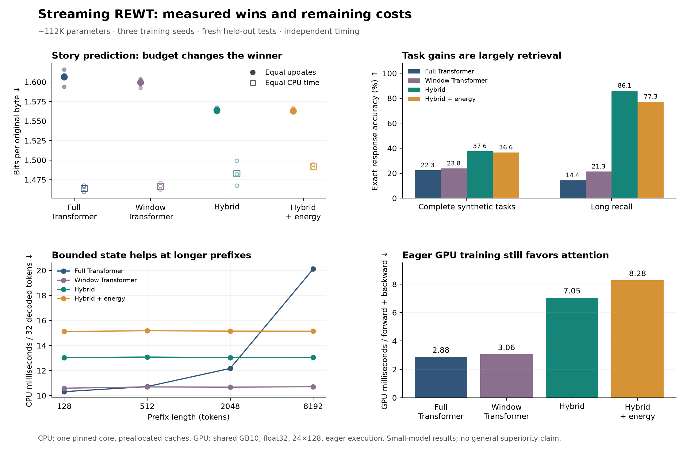

# Streaming REWT: matched Transformer comparison

This study completed **36 cold fits** across three seeds. It evaluates an opt-in autoregressive hybrid with gated delta memory, local attention and optional latent energy refinement. The comparison uses modern full-attention and window-attention controls, matched to within 0.1% of allocated parameters. **This is a bounded comparison, not evidence of superiority in every setting.**

## Language and generated task accuracy

| Model | Parameters | Story bpb, equal updates ↓ | Story bpb, equal CPU ↓ | Complete task accuracy ↑ | Long recall ↑ |
|---|---:|---:|---:|---:|---:|
| Full Transformer | 111,680 | 1.6065 | 1.4641 | 22.34% | 14.35% |
| Window Transformer | 111,680 | 1.5997 | 1.4666 | 23.78% | 21.30% |
| Hybrid, no refinement | 111,784 | 1.5638 | 1.4828 | 37.62% | 86.11% |
| Hybrid + energy | 111,784 | 1.5631 | 1.4926 | 36.63% | 77.31% |

All cells average all three seeds. Lower bits per original byte is better. Language fits use 768 updates / 2,359,296 BPE target tokens. Equal-CPU fits use 90 measured training process seconds, with at most one-update overshoot. Task fits are separate cold models trained for 1,536 updates on raw-byte prompts; they do not inherit language pretraining or the earlier structured reasoner.

The task test has 576 prompts (288 semantic identities, each in familiar and withheld wording). Long recall adds 72 prompts with 32, 64 or 128 distractors. Inference receives only the prompt and generates the complete response autoregressively. No symbolic solver or task metadata participates in generation.

| Model | Arithmetic complete | Rule-chain complete | Recall complete | Familiar wording | New wording |
|---|---:|---:|---:|---:|---:|
| Full Transformer | 1.56% | 2.60% | 62.85% | 25.12% | 19.56% |
| Window Transformer | 0.87% | 3.65% | 66.84% | 24.54% | 23.03% |
| Hybrid, no refinement | 3.65% | 11.63% | 97.57% | 40.86% | 34.38% |
| Hybrid + energy | 1.74% | 8.68% | 99.48% | 39.24% | 34.03% |

The family breakdown is essential: aggregate task accuracy must not be described as general reasoning if it is driven by recall. Greedy story samples also remain repetitive and sometimes incoherent; lower held-out loss alone does not establish high-quality prose. [Unselected samples](validation_samples.json) preserve a fixed prompt for all four variants.

| Model | Task seed 26301 | Task seed 26302 | Task seed 26303 |
|---|---:|---:|---:|
| Full Transformer | 31.94% | 28.99% | 6.08% |
| Window Transformer | 34.20% | 31.60% | 5.56% |
| Hybrid, no refinement | 35.76% | 37.33% | 39.76% |
| Hybrid + energy | 35.07% | 36.98% | 37.85% |

Both attention controls have a weak third task seed. The hybrid beats the full Transformer in every paired task seed, but the mean gain is enlarged by that unstable baseline run. All arms used one common learning-rate recipe without architecture-specific tuning. These results do not establish performance against the best-tuned Transformer.

## Paired uncertainty

Paired bootstrap over documents or family/depth-stratified semantic IDs; three observed seeds held fixed. These intervals do not quantify uncertainty over arbitrary future training seeds.

| Comparison | Mean difference | Paired 95% interval |
|---|---:|---:|
| language_hybrid_minus_transformer_bpb | -0.0427 bpb | [-0.0481, -0.0373] bpb |
| language_hybrid_energy_minus_transformer_bpb | -0.0434 bpb | [-0.0491, -0.0378] bpb |
| compute_hybrid_minus_transformer_bpb | +0.0187 bpb | [+0.0132, +0.0239] bpb |
| compute_hybrid_energy_minus_transformer_bpb | +0.0286 bpb | [+0.0232, +0.0340] bpb |
| tasks_hybrid_minus_transformer | +15.2778 pp | [+13.6574, +16.8981] pp |
| tasks_hybrid_energy_minus_transformer | +14.2940 pp | [+12.7879, +15.7986] pp |

Per-seed values and all long-context results are in [summary.json](summary.json). Test outcomes were opened only after every declared run finished. Validation chose checkpoints; no test outcome chose a training configuration.

## Does energy refinement help?

| Frozen energy model | Refinement enabled | Same weights, refinement disabled |
|---|---:|---:|
| language | 1.5631 bpb | 1.5693 bpb |
| compute | 1.4926 bpb | 1.4980 bpb |
| tasks | 36.6319% | 36.6319% |

The separately trained hybrid without energy is also reported above. A frozen intervention and a separately trained ablation answer different questions; neither should be omitted. Energy descent remains an internal optimization property rather than a correctness certificate.

## CPU execution and actual carried storage

The benchmark uses one pinned CPU core after study training finishes, alternating model order across five decode and seven forward/backward repetitions. Both Transformer controls use preallocated caches. Decode consumes the same 32 tokens for every arm, rather than timing different generated outputs. Prefill uses 128-token chunks. The machine is shared with other user work.

| Model | Forward + backward, 24×128 | Decode 32, prefix 128 | Decode 32, prefix 8192 | Allocated state at prefix 8192 |
|---|---:|---:|---:|---:|
| Full Transformer | 45.50 ms | 10.32 ms | 20.11 ms | 8,421,376 bytes |
| Window Transformer | 47.05 ms | 10.59 ms | 10.71 ms | 64,512 bytes |
| Hybrid, no refinement | 55.64 ms | 13.03 ms | 13.06 ms | 36,864 bytes |
| Hybrid + energy | 58.05 ms | 15.12 ms | 15.14 ms | 36,864 bytes |

Training microbenchmarks include forward, cross entropy and backward, excluding optimizer work. Study CPU budgets include optimizer and preprocessing, excluding validation and checkpoint I/O. Memory values count allocated cache/state storage, not total process RAM or parameter storage. Full-attention capacity includes space for the 32 continuation tokens. Detailed intermediate lengths, prefill cost, CPU and wall samples are in [benchmark.json](benchmark.json).

Early equal-update timing was unpinned on a CPU with two core types and is descriptive only. Before the equal-CPU fits, workers were pinned to matching performance cores; [the change is recorded](worker_affinity.json). The separate fixed-core benchmark is the source for execution comparisons.

## Verification and reproducibility

- Audited 9,504 generated responses against the independent scorer; all checkpoint hashes and frozen source/data hashes match.
- Exact per-seed batch hashes match across all equal-update arms.
- Chunked delta recurrence and gradients match a separate sequential implementation; causal, chunked and token decoding parity pass.
- Owned preallocated sessions match full forward calls, preserve earlier outputs, and reject changed weights or capacity overflow.
- GB10 float32 CPU/GPU and cached-decoding checks pass with matching greedy predictions. This is numerical verification, not a GPU throughput claim.

Total full-study training CPU time was 3346.8 seconds; validation consumed 49.4 additional process seconds. This excludes the eight preliminary 128-update validation pilots, kernel tests, benchmark, data preparation and report work.

See [the architecture and exact math](DESIGN.md), [the frozen plan](plan.json), [all test results](test_results.json), and [CUDA verification](cuda_verification.json).

```bash
OMP_NUM_THREADS=1 MKL_NUM_THREADS=1 OPENBLAS_NUM_THREADS=1 \
  taskset -c 5,6,8 .venv/bin/python scripts/study_rewt_streaming.py \
  --output reports/rewt_streaming_replication --runs runs/rewt_streaming_replication \
  --prepare --train --workers 3
OMP_NUM_THREADS=1 MKL_NUM_THREADS=1 OPENBLAS_NUM_THREADS=1 \
  .venv/bin/python scripts/study_rewt_streaming.py \
  --output reports/rewt_streaming_replication --test --workers 3
.venv/bin/python scripts/benchmark_rewt_streaming.py --study reports/rewt_streaming_replication
.venv/bin/python scripts/summarize_rewt_streaming.py --study reports/rewt_streaming_replication
```

Select CPU IDs available on the reproduction machine. A new task preparation excludes previously recorded test identities, so its task test is a fresh replication. Story partitions are the fixed document-disjoint corpus from this study. Preserve partial or completed directories rather than overwriting them.

Sample a saved language checkpoint:

```bash
.venv/bin/python scripts/sample_rewt_streaming.py \
  --checkpoint runs/rewt_streaming_20261026/language_hybrid_26301/best.pt \
  --prompt 'Once upon a time, ' --tokens 96
```

The stored hybrid sampler above uses a fixed seed checkpoint, not one chosen for attractive generations. All models are small research prototypes; broad-domain quality, deeper reasoning, long-context retention and competitive GPU throughput remain open.

## Shared-device GPU timing

A separate NVIDIA GB10 snapshot used eager float32 forward, cross entropy and backward at batch 24 × 128, with TF32 disabled, 15 alternating repetitions and three warmups. It excludes optimizer work, compilation and mixed precision. Other GPU work remained active; these are scoped measurements rather than exclusive-device peak throughput.

| Model | Median CUDA-event interval | Median wall time |
|---|---:|---:|
| Full Transformer | 2.877 ms | 3.014 ms |
| Window Transformer | 3.063 ms | 3.150 ms |
| Hybrid, no refinement | 7.055 ms | 7.170 ms |
| Hybrid + energy | 8.281 ms | 8.303 ms |

GPU utilization was 7 % before and 15 % after this short benchmark. Event intervals include idle gaps between host launches. The small delta solves and refinement operations have overhead; this implementation does not establish a GPU training-speed advantage. [Raw timings and numerical checks](cuda_benchmark.json).

## Comparison figure



[PDF for presentation use](comparison.pdf)
