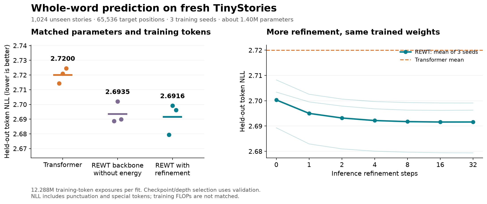

# Whole-word REWT versus a matched Transformer — October 29, 2026

**REWT wins this fresh TinyStories comparison in all three confirmation seeds.**
Mean held-out prediction loss is **2.691568**, versus **2.719975** for the
Transformer, with approximately equal parameter counts and identical training
token budgets. The predefined success criterion is met. The result applies to
these small word models on this dataset.

Extra refinement also improves the same trained models: moving from two steps
to the validation-selected 16–32 steps lowers mean test NLL by **0.001610**.
That improvement is real within this evaluation but small. Most of the advantage
over the Transformer comes from the REWT backbone. The separate no-energy
training control is close enough that a benefit from training an energy head
over training that backbone alone is **not established**.



## Fresh held-out results

The test contains **1,024 previously unused stories and 65,536 target positions**.
All rows below average three new training seeds. Checkpoints and inference depths
were selected on validation before any fresh test scoring.

| Model | Parameters | Token NLL ↓ | Token perplexity ↓ | Next-word accuracy ↑ | Known-word NLL ↓ |
|---|---:|---:|---:|---:|---:|
| Standard causal Transformer | 1,401,472 | 2.719975 | 15.1799 | 36.28% | 2.987315 |
| REWT backbone, separately trained without energy | 1,394,856 | 2.693503 | 14.7834 | **36.86%** | 2.960023 |
| REWT with supervised energy refinement | 1,401,144 | **2.691568** | **14.7548** | 36.78% | **2.958567** |

REWT with refinement has **2.80% lower perplexity** than the Transformer and
**0.50 percentage points higher next-word accuracy**. Its NLL advantage is
0.028407 nats/token. A paired bootstrap over training seeds and documents gives
a 95% interval for the difference, REWT minus Transformer, of
**[-0.036716, -0.019815]**. Three seeds still limit inference about training
variability at larger scales.

The energy model's difference from the separately trained no-energy backbone is
only -0.001935, with interval **[-0.010582, +0.007234]**. One seed favors the
backbone without energy, which also has slightly better average word accuracy.
Do not attribute the entire Transformer comparison win to energy refinement.

| Seed | Transformer NLL | No-energy backbone NLL | Refined REWT NLL | Validation-selected steps |
|---|---:|---:|---:|---:|
| 291201 | 2.714364 | 2.688665 | **2.679398** | 32 |
| 291202 | 2.720999 | 2.701963 | **2.699114** | 16 |
| 291203 | 2.724563 | **2.689883** | 2.696192 | 16 |

Token NLL includes punctuation, EOS and the unknown label. Known-word NLL is
restricted to recognized word targets. Word accuracy uses the full-vocabulary
prediction at word positions: punctuation predictions there are errors, and
every unseen word is counted as incorrect even if `<unk>` is predicted.
All models use the same train-only 8,192-entry vocabulary and evaluation positions.

## What extra refinement actually changes

These are inference ablations on the **same three trained REWT checkpoints**.
No additional training occurs between rows. The test curves are diagnostic;
they were not used to choose deployment depth.

| Refinement steps | Mean fresh test NLL |
|---:|---:|
| 0 | 2.700319 |
| 1 | 2.695004 |
| 2 | 2.693178 |
| 4 | 2.692177 |
| 8 | 2.691748 |
| 16 | 2.691585 |
| 32 | 2.691596 |
| Each model's validation choice: 32, 16, 16 | **2.691568** |

The validation-selected depth beats two steps in all three seeds. The paired
NLL difference is **-0.001610**, with 95% interval **[-0.001913, -0.001324]**.
Against zero steps, the decrease is **0.008750**.

There is little benefit beyond eight steps. The 8→32 mean difference is
-0.000152, and its interval crosses zero. Sixteen steps has a slightly lower
mean than 32 in the diagnostic curve. The saved default remains the previously
selected 32-step checkpoint; it was not changed after inspecting test results.
There is no guarantee that extra steps improve an individual prediction.

Simply increasing the original October 28 checkpoint's steps did not work:
its development validation NLL was 3.317467 at two steps and 3.319205 at 32.
The implementation therefore adds context-dependent Fourier phases and trains
against prediction loss at steps 2, 4 and 8, with a small penalty for later
training predictions worsening. Internal energy descent is checked separately
from held-out prediction loss. [Architecture and objective](DESIGN.md).

## What was matched

Each confirmation fit receives **12,288,000 target-token exposures**: 12,000
updates, batch 16, context 64. Paired seeds use exactly the same training crops.
All models use width 128, two blocks, four heads, tied embeddings, RMSNorm,
RoPE and SwiGLU. The Transformer has two attention blocks and feedforward width
288; REWT has delta memory followed by attention and feedforward width 256.
The Transformer has 328 more parameters than the refined model.

All use AdamW, weight decay 0.01, clipping at 1.0, 100-step warmup, and cosine
decay to 15% of peak learning rate. Longer development comparisons test
0.0015, 0.003 and 0.006 for both architectures; 0.003 wins for both. All 14
development trials, including failures and alternative energy recipes, are in
[the development summary](development_summary.json).

**Training FLOPs are not matched.** Refinement training evaluates three
vocabulary losses instead of one and backpropagates through eight energy steps.
Recorded mean training-only time is 107.71 seconds for the Transformer,
146.92 seconds for the backbone, and 206.87 seconds for refined REWT. The GB10
was shared, including during correctness checks, so these are workload records,
not an isolated speed benchmark. No equal-compute or speed advantage is claimed.

## Default model and historical improvement

The prediction CLI now uses
`runs/rewt_word_refinement_20261029/recommended.pt`. This is seed 291201, selected
by the lowest validation NLL among the three refined checkpoints **before test
evaluation**, with 32 refinement steps. It has test NLL 2.679398, perplexity
14.5763 and next-word accuracy 36.91%. The main comparison above uses all three
seeds, not just this selected model.

```bash
.venv/bin/python scripts/predict_rewt_words.py --prompt 'Once upon a' --top 5
.venv/bin/python scripts/predict_rewt_words.py \
  --prompt 'The little girl went to the' --generate 24
```

The fixed example `Once upon a` predicts `time` with 99.63% probability. One
unedited continuation is:

> Once upon a time, there was a little girl named Lily. She loved to play outside in the garden. One day, she found

On the exact same fresh sample, the historical October 28 checkpoint scores
NLL 3.353630, perplexity 28.6064 and word accuracy 28.57%. It had one-tenth the
training-token budget. The improvement over that checkpoint includes additional
training and architecture changes; it is not an isolated refinement effect.

The vocabulary is embedded in each checkpoint. Known words remain single
tokens, punctuation is separate, and unknown words map to `<unk>` without byte
fallback. The original checkpoint remains available explicitly at
`runs/rewt_words_20261028/best.pt`. Model weights and downloaded data remain local
under existing Git exclusions. The LFM3 tokenizer and converted models are unchanged.

## Data isolation and verification

The new test uses complete documents from bytes 16,777,216–19,447,281 of the
pinned official TinyStories validation file. All **79,662 previously indexed
document identities** were excluded. The range contains 2,967 accepted fresh
documents and no identity overlap with prior local data. The fixed sample uses
1,024 distinct document-contained crops. Training, validation and vocabulary
were reused unchanged. [Data audit](data_audit.json),
[fresh corpus manifest](fresh_manifest.json), [source metadata](fresh_source.json).

- **326 REWT regression tests pass**; [test output](tests.txt).
- The actual 32-step word checkpoint matches **72 reference generation steps**
  through the optimized CUDA-graph decoder, including attention-window wrapping:
  [GPU cache audit](cuda_cache_audit.json).
- A singleton phase-broadcast bug caught during generation verification is
  corrected. The supported training-shape forward values and gradients match
  bit for bit on CPU and CUDA. All three saved validation NLLs are exactly
  unchanged with the corrected code: [broadcast audit](phase_broadcast_audit.json)
  and [validation audit](post_fix_validation_audit.json). Training source
  snapshots precede this inference fix; use the current model implementation
  for single-token generation.
- Training-only supervision, causal prefix behavior, energy descent, checkpoint
  loading, word metrics and cache agreement are covered by the tests.
- The default CLI was exercised on the selected model:
  [complete prediction output](default_prediction.json).

## Reproduction and raw evidence

- [Training, evaluation and inference commands](REPRODUCING.md).
- [Frozen confirmation-training protocol](confirmation_training_protocol.json).
- [Default checkpoint selection before test](recommended_selection.json).
- [Frozen test offsets, model hashes and criteria](final_test_protocol.json).
- [All aggregated metrics and paired confidence intervals](comparison.json).
- Per-model and per-depth document metrics are in `test/`; per-update training
  logs, configurations and exact source snapshots are in the run subdirectories.
- [Exportable vector figure](comparison.pdf).

The result supports a modest loss advantage over this matched small Transformer
and a small inference-time gain from extra refinement. It does not establish
general assistant quality, superiority on other datasets, superiority at equal
compute, or an optimal number of steps for arbitrary prompts.
