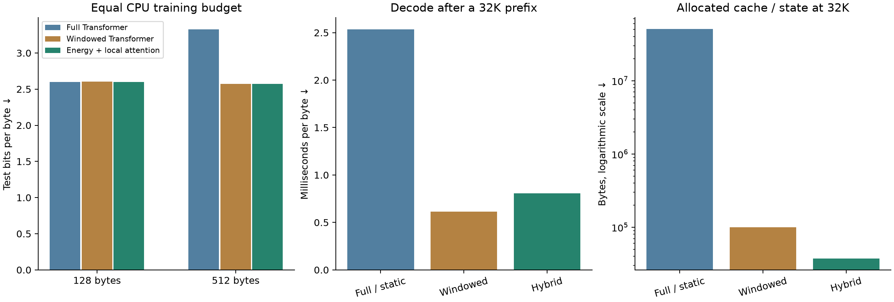

# Stronger native-model comparison

The hybrid did not pass the predeclared quality gate against both Transformer controls at equal CPU training budgets. This remains a small, one-corpus CPU experiment; it does not establish general superiority over Transformers or large language models.

The energy implementation is faster without changing its mathematical recurrence or weight format. At 32,768 bytes, hybrid decoding is **3.15× as fast as the preallocated full-Transformer baseline**, with **1,363.4× less allocated cache/state**. The windowed Transformer remains a separate, bounded-memory control.

## Equal-compute language prediction

Three freshly initialized seeds per arm, approximately 145,000 parameters, CPU float32, batch eight, 128-byte training sequences. Each architecture gets the same three-rate tuning budget and 90 process CPU seconds of training per main fit. Lower bits per byte are better.

| Model | Test bpb, 128 | Test bpb, 512 | CPU update seconds | Wall update seconds | Training bytes |
|---|---:|---:|---:|---:|---:|
| Full Transformer | 2.5991 | 3.3265 | 90.02 | 101.89 | 2,941,269 |
| Windowed Transformer | 2.6034 | 2.5747 | 90.01 | 101.12 | 2,889,728 |
| Energy + local attention | 2.5981 | 2.5699 | 90.03 | 107.09 | 2,026,155 |

The selected peak learning rates are {'softmax': 0.002, 'local_softmax': 0.002, 'hybrid': 0.004}. Each checkpoint is selected on validation only, and all main fits are frozen before test. Faster models receive more examples. This comparison matches measured CPU update time, not FLOPs, GPU compute, or training bytes. The 512-byte test extrapolates from 128-byte training.

Training used one thread without processor affinity on a shared host with different CPU core types. Other work caused high load during seed 303, reducing the number of updates completed within its CPU budget. Interleaved model updates reduce order bias but cannot remove memory-bandwidth contention or core-frequency differences. This limits the precision of the compute comparison.

| Context | Control | Hybrid minus control, bpb | Conditional 95% interval |
|---:|---|---:|---:|
| 128 | Full Transformer | -0.0010 | [-0.0080, +0.0058] |
| 128 | Windowed Transformer | -0.0053 | [-0.0124, +0.0015] |
| 512 | Full Transformer | -0.7566 | [-0.7771, -0.7368] |
| 512 | Windowed Transformer | -0.0048 | [-0.0091, -0.0007] |

Negative differences favor the hybrid. Intervals resample windows after averaging paired differences over the same three seeds; they do not capture all seed uncertainty. Crops can overlap. The equal-budget search is modest and does not establish optimal tuning for either architecture.

## Inference with a stronger Transformer cache

Identical preserved selected weights, 256-byte prompt chunks, batch one, 16 teacher-forced decoding tokens, six balanced rounds. Timings exclude sampling and serving. Full Transformer uses PyTorch scaled-dot-product attention and RoPE. The static version reserves the complete cache, avoids growing KV concatenations, and removes an unnecessary mask during unsegmented single-token decoding.

| Model / implementation | Decode ms per byte, 32K | Prefill seconds | Allocated cache/state bytes |
|---|---:|---:|---:|
| Full Transformer, growing cache | 6.591 | 11.863 | 51,143,040 |
| Full Transformer, preallocated cache | 2.534 | 11.360 | 51,143,040 |
| Hybrid, preserved kernel | 1.760 | 0.900 | 37,512 |
| Hybrid, improved kernel | 0.805 | 0.527 | 37,512 |
| Windowed Transformer | 0.613 | 0.401 | 99,864 |
| Energy only | 0.844 | 0.558 | 6,336 |

The old timing report used a growing cache. These measurements supersede that implementation comparison, without rewriting the historical result. Allocation counts cover carried tensors, including reserved static capacity; they are not peak process memory. Model weights and transient activations are excluded. Shorter contexts and CPU-time measurements are in [the raw summary](benchmark.json).

Inference CPU affinity was [19]; the host's one-minute load ranged from 5.3 to 8.7. These shared-host timings are not isolated-machine throughput guarantees; all round values and ranges are retained.

## Kernel improvement

At the original chunk size of 32, median hybrid update time changed from **55.20 to 31.63 ms** (1.75×). Chunk size eight measured **26.92 ms** (2.05× versus the preserved implementation); the new training experiment uses this setting. These are matched-weight timing probes, separate from the newly trained models.

Numerical and gradient comparisons use the preserved source and independent serial recurrences. Both energy reads, final states, document resets, carried states and causality are tested. The optional full-attention static cache also matches the original full and chunked outputs. The GPU was occupied; no new accelerator performance or large-model training claim is made.

## Artifacts and scope

- [Protocol and reproduction commands](METHOD.md)
- [Training log](training_controlled.log), [benchmark details](benchmark.json), and [selected checkpoint record](selected_checkpoint.json)
- Full frozen plan, selection, per-seed histories, datasets and test-window rows: `runs/compute_matched_controlled/`
- Validation-selected hybrid: `runs/stronger_native/selected_hybrid.pt` (seed 202)
- Frozen training source: `runs/stronger_preservation/training_source.tar.gz`
- 175 earlier reports and checkpoint artifacts verified unchanged.

The earlier large checkpoints were preserved. This is a mixed energy-and-attention model, not an energy-only replacement for every Transformer component. Long-prefix timing does not measure how well either model uses distant information. One small corpus, short training contexts and native CPU timings cannot settle large-scale language quality, reasoning, GPU throughput or production serving performance.
